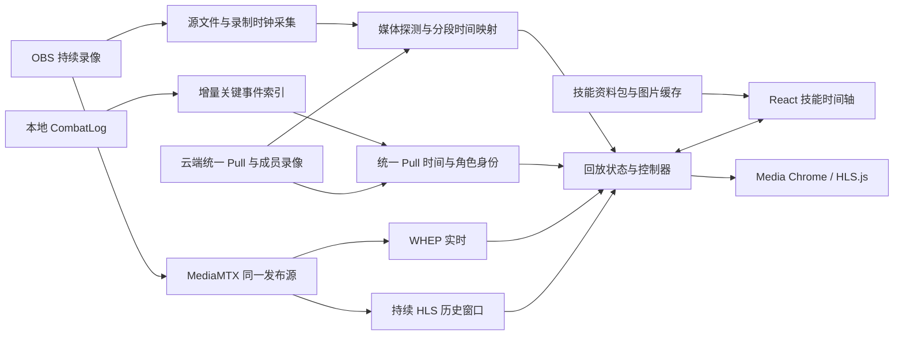
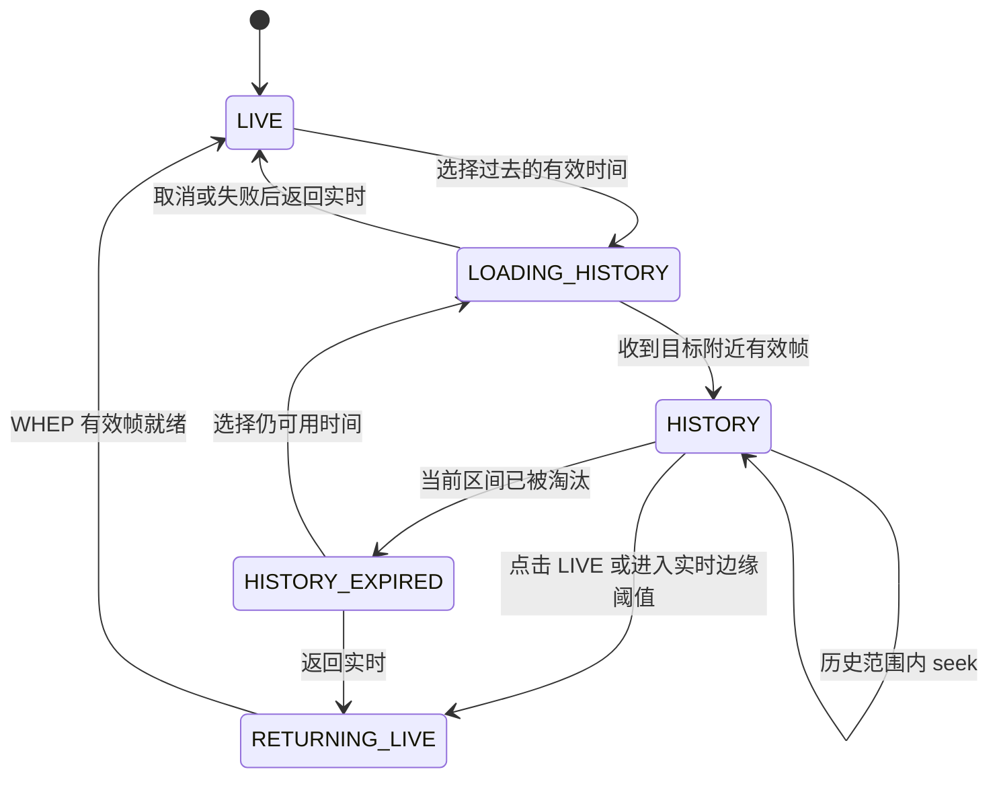

# 录制、技能时间轴、多视角与直播回看的实施方案

日期：2026-10-16，更新：2026-10-17（Asia/Shanghai）。状态：本机复盘主要能力已实现并完成自动化及原生冒烟验证，实战对齐精度和大规模事件查询尚待补全；版本 B、C 未实施。原始现状依据见 `../research/replay-gap-and-plan.md`，ReviewTool 行为证据见 `../research/reviewtool-timeline-seek.md`。

### 实施进度（2026-10-17）

- 已实现：capture／processing／events 拆分、有符号及分段映射、v1→v2 备份迁移、媒体包校准、OBS 录制时钟采样与不连续检测、稳定事件身份、死亡／光环／打断／驱散、13 项离线技能资料和真图标、WCL 资料导入与图片缓存、筛选／分组／详情、拖动／键盘轴交互、加载期待跳转与连续 seek 保护、书签和媒体参数恢复、正负手动微调、处理重试及损坏成片重建。
- 用户提供的共享版归档已经完整校验并提取到隔离 `probe/bin`；原 FFmpeg 不升级、不混用 DLL。来源、摘要与布局见第 16 节。
- 已执行：Rust 60 项通过、0 失败、1 项常规忽略（媒体夹具生成器另行显式运行通过）；Node 8 项通过；浏览器 14 项通过；真实 Tauri／WebView2 5 项通过；TypeScript／Vite 构建成功。详见 [验证报告](../research/replay-validation-2026-10-17.md)。
- 未完成：至少三场实战日志／画面锚点与不同编码器的误差验收、事件分页和增量通知、全量技能及职业／机制分类、直播 DVR、上传和多人云端。媒体校准通过不等于已证明实战日志同步精度，版本 A 尚未整体验收。

## 1. 交付目标与技术选择

完成以下用户流程：打开一场录像，查看真实技能图标和事件，拖动战斗时间轴或点击事件定位画面；切换成员保持战斗时间；直播中向过去回看，并能返回实时。

沿用 Tauri 2／Rust、React 19、Ant Design、Media Chrome、hls.js、OBS WebSocket 和 MediaMTX。React 只处理交互与媒体播放，Rust 负责日志、系统能力、文件、资料缓存及本地服务。云端沿用项目既定的 FastAPI、PostgreSQL、Celery、Redis 和对象存储方向。

分三次交付：

| 版本 | 范围 | 完成后可使用的能力 |
| --- | --- | --- |
| A：本机复盘 | M0～M3 | 准确映射、缺片识别、技能图标、死亡与光环等事件、拖动定位、播放恢复与失败重试 |
| B：本机直播回看 | M4 | 持续历史窗口、直播战斗事件、向过去定位和返回实时 |
| C：团队复盘 | M5～M6 | 可靠上传、WCL 增强、统一 Pull、多成员录像及保持时间切换 |

版本 B 不依赖云端，可以先于 C 交付。三个版本共用统一战斗时间和媒体映射契约；不提前引入支持任意第三方播放器的插件系统。

本方案将“首次离线图标覆盖”明确为首版随包资料范围内可用，未知技能联网补齐后缓存；不承诺安装包含所有历史版本技能。直播历史窗口建议初值为最近 10 分钟，不作为当前已接受的产品默认值。精度候选门槛为正常、完整、已校准样本误差不超过 500ms，必须实测后冻结。

## 2. 总体架构



业务时间以开战为 0ms；媒体时间由具体录像或历史流适配器提供。资料和图标变化不改变事件时间，界面图标避让不改变定位结果。

## 3. 数据契约

以下是拟新增或升级的契约，不是当前已有字段。

### 3.1 录制与媒体锚点

| 契约 | 必要字段 | 约束 |
| --- | --- | --- |
| `RecordingClockSample` | `processClockId`、`outputEpochId`、`unixMs`、`monotonicNs`、`obsOutputDurationMs`、`roundTripMs` | 单调时间只在同一进程时钟域比较；OBS 重启、进度归零或不连续时开启新输出区段 |
| `SourceMediaInfo` | `sourceId`、路径、首尾视频 PTS、`timeBase`、关键帧索引、实际时长、锚点引用 | PTS 以整数 tick 与有理时间基保存，避免早期浮点累计误差 |
| `MappingInterval` | `pullStartMs`、`pullEndMs`、`videoStartMs`、`videoEndMs`、`sourceId` | 只描述真实有画面的连续区间；同一录像的有效区间不得有歧义重叠 |
| `ReplayMapping` | `version`、`revision`、`intervals`、`quality`、`method`、`uncertaintyMs` | 质量为 `verified`、`estimated` 或 `unavailable`；无法量化不确定度时使用空值 |

单区间定位采用：

```text
scale = (videoEndMs - videoStartMs) / (pullEndMs - pullStartMs)
videoMs = videoStartMs + (pullMs - pullStartMs) × scale
pullMs = pullStartMs + (videoMs - videoStartMs) / scale
```

第一版保持 scale=1，区间真实边界不能用请求裁切长度冒充；若实际时长不一致，先查缺片、PTS 和边界，不直接拟合比例掩盖问题。后续有多锚点漂移证据时才发布经过验证的比例。

普通连续录像可以合并为一个区间，天然允许负偏移。区间按左闭右开处理，最终媒体终点只作为边界，不请求播放不存在的末帧。

映射函数返回三种明确结果：`mapped(videoMs)`、`gap(previous,next)`、`unavailable(reason)`。目标在缺片中不静默跳到邻近画面。媒体时间原点由 HLS 适配层单独处理，不能重复加入业务 offset。

用户微调定义为“同一战斗事件在视频中向后移动多少毫秒”；正值表示定位到更晚的视频位置。微调后重新计算实际覆盖范围，不能仍把移出媒体范围的事件标为可播放。

### 3.2 事件与技能资料

| 契约 | 必要字段 |
| --- | --- |
| `ReplayEvent` | `eventId`、`pullTimeMs`、`kind`、`sourceGuid`、`targetGuid`、`spellId`、日志技能名、必要的叠层／额外技能字段、`provenance` |
| `SpellMetadata` | `gameVersion`、`spellId`、`locale`、名称、图标引用、分类、资料版本 |
| `TimelineFilter` | 事件类型、人物 GUID、技能 ID、轨道配置 |

首版本地 eventId 绑定日志文件身份和事件起始字节位置；不能用“时间戳＋技能 ID”去重，避免合并同毫秒不同目标事件。服务端事件使用独立来源命名空间，WCL 增强通过显式对应关系替换／关联本地事件，不能把两份事件直接追加显示。

首批类型包括施法开始／成功、玩家死亡、Buff／Debuff 应用／移除／叠层、打断和驱散。死亡日志未直接给出致死技能时保持未知；除非有明确关联证据，不把最后一次伤害自动认定为死因。

数据层保留观测到的团队事件，界面默认展示 Boss 关键机制、本人关键技能和死亡；其他人物和技能按需筛选。友方召唤物不能因为名字像玩家就自动归属本人。

### 3.3 回放状态

应用级 `ReplayProvider` 保存当前 Pull、视角、战斗时间、播放意图、倍速、音量和筛选。播放器内部保存当前媒体时间、缓冲、连接和错误等瞬时状态。

跨进程恢复的用户偏好统一进入 Rust LocalStateStore 的 `replay` 区段：最后查看的录像／战斗时间书签、倍速、音量、轨道筛选和按录像保存的手动校准。实际播放、录制和直播连接不从磁盘恢复为运行中。

录像事实、源片段和映射写录制业务索引与旁车文件；图片及技能资料写资料缓存。LocalStateStore 不保存大量事件、分片或媒体连接对象。

## 4. M0：准备与验证样本

交付：冻结契约、恢复规则及可重复使用的验证样本，解决目录与文档冲突。

任务：

1. 将当前研究中的“实际具备／尚未实现”同步到实施说明；在进入云端阶段前，按较新会话决定统一 Archon 上传、WCL 标准事件方向，客户端继续只读监听本地日志。
2. 为直播 DVR 明确扩展现有“本机 HLS 不参与直播”的边界。WHEP 保持实时用途，HLS 新增为历史回看来源，不把直播整体改为 HLS。
3. 准备至少三场完整录像的日志与可识别画面锚点，另准备晚起录、中间缺片、跨源文件、连续 Pull、进程重启和时钟调整场景。人工标注事件对应画面，用于衡量真实误差。
4. 给媒体处理资源加入受管 ffprobe，补充摘要及打包资源声明。优先同构建；原始构建不可取得时，使用独立静态版或自带完整 DLL 依赖的隔离共享版，禁止加载旧 FFmpeg 的 libav DLL，并以实际媒体核对输出契约。不安装全局版本，不升级既有 FFmpeg。已采用隔离共享版。
5. 选取一份真实报告的技能资料制作初始版本资料包并缓存对应图片，明确游戏版本与更新来源；构建任务不依赖开发机器个人缓存。

验收：能区分媒体时间误差、日志／采集延迟、事件解析错误；样本及预期来源明确。没有媒体锚点的场景标为估算，不据此宣布达到精度目标。

## 5. M1：准确定位与缺片映射

任务：

1. OBS 连接后、输出开始、文件分割、暂停恢复和重连时采集录制时钟样本；只使用同一 outputEpoch 内连续进度，记录采样往返时间。
2. 将文件创建时间、OBS 事件到达时间与媒体锚点分开保存。系统墙钟跳变时开启新的映射区段，不能让已有视频时间突然平移。
3. 探测源文件、每个裁切段和最终输出。建立输出首个可显示帧对应的源媒体位置，核对 stream copy、时间戳归零和 concat 的影响；必要时匹配编码包指纹并记录匹配歧义。
4. 只有在源媒体位置与录制时钟锚点均成立时，生成可信分段映射；媒体探测本身不能恢复采集画面的墙钟。用 M0 的日志／画面锚点确认采集和编码延迟。
5. 将旧无符号 videoZeroMs 的使用迁移到版本化映射；处理晚起录、缺首尾、内部缺片及跨源文件，保留前后各 5 秒视频但战斗轴仍从 0 到战斗结束。
6. 输出映射质量、生成方法及诊断。手动微调通过 Rust 保存，前端只展示与应用，不直接修改录像事实。

验收：开头／中段／结尾锚点均可定位；战斗第 30 秒、录像晚起 10 秒时映射到视频第 20 秒；缺口前后能够双向换算，缺口内明确返回无画面。没有足够依据的旧录像标为 estimated。

## 6. M2：事件索引、技能资料与图片

任务：

1. 从现有唯一 CombatLogReader 分发完整行，同时处理 Pull 边界和关键事件，不创建第二个竞争读取游标。
2. 将当前施法解析迁入事件领域，按事件布局扩展死亡、光环、打断和驱散。独立记录解析失败数量与日志位置；不因一行失败中止整场，也不静默声称索引完整。
3. 活跃 Pull 的关键事件在内存持续累积，按批发布增量；结束后生成带版本的 `combat-log.json`。重启时只重读活动 Pull 的日志区间重建事件，不扫描整个历史日志；原日志已丢失时说明不可恢复。
4. 用独立事件索引版本管理重建。查询列表只返回录像摘要；选中 Pull 后分页读取事件，新增事件通过序号补取，避免每两秒重新返回全部录像的全部事件。
5. Rust 技能资料服务按游戏版本、语言和 spellId 查询资料包／缓存，限制远端资料和图片来源、去重并发下载，以原子写入发布缓存；失败不缓存为永久不存在。
6. 图片通过受控本地协议提供，前端不拼接第三方图片地址。未知技能显示日志名和占位图，联网补齐后更新对应图片；不因图标下载失败禁用时间轴。
7. Encounter／关键技能分类作为版本化资料配置；没有职业、专精、机制资料时显示未知或全部观察事件，不伪造分类。

验收：相同技能不同人物／目标不会错误合并；事件顺序稳定；重建不会重复；光环开始／移除和死亡可定位；已缓存图标离线可用，未知图标有回退。没有初始真实资料包不能把技能图标工作包标为完成。

## 7. M3：回放控制、UI 与恢复

### 7.1 播放控制流程

```text
用户选择 Pull 时间
→ 更新业务时间及待执行 seek
→ 查当前视角有效映射区间
→ 等待媒体 metadata 和对应可播放范围
→ 转换媒体时间并设置 currentTime
→ 等待 seek 完成及目标附近有效帧
→ 接受实际播放时间并恢复正常游标回写
```

每次换源与 seek 带递增操作序号，最后一次意图生效；旧源的事件回调、超时和错误不能写入新源状态。结束暂停／播放由用户意图决定，不因自动加载完成擅自播放。

播放期间优先以视频帧回调读取 mediaTime 更新游标，缺少支持时回退；避免逐帧重渲染全部事件列表。等待、拖动和 seek 期间，显示预览／目标时间并阻止旧媒体位置覆盖它。

### 7.2 页面设计

继续使用现有“左侧视角与录像状态、右侧单播放器、下方事件时间轴”。媒体进度／音量／倍速／全屏使用 Media Chrome，业务战斗轴处理技能与战斗时间。

- 默认三类轨道：Boss 机制、当前人物关键技能、死亡；光环及其他成员按筛选开启。
- 技能使用图片，Tooltip 展示名称、人物、类型与发生时刻；点击弹层可回看、复制技能 ID、打开可选法术外链。
- 事件回看默认提前 3 秒，死亡前文沿用产品约定的 15 秒；普通空白轴定位不提前。事件时间和预览起点分别展示。
- 图标重叠使用分组和轻量避让，弹层列出组内事件。分组按事件语义和目标区分，不能为减少图标删除业务事件。
- 指针拖动只更新预览，释放后提交 seek；取消拖动恢复实际时间，键盘操作使用同一范围限制。
- 手动校准通过 Ant Design 数值控件提供正负毫秒及重置入口，显示当前为自动／手动校准；不在普通成员列表堆叠媒体技术参数。
- 页面覆盖加载、无录像、无事件、缺图、缺片、低可信度、错误和处理中；1440×900 与 1080×720 下不遮挡时间轴和控制栏。
- App 根部注入 ReplayProvider。离开回放后可释放实际媒体，返回时按业务书签重新加载定位，恢复前不显示虚假的播放中状态。

### 7.3 处理任务恢复

为失败录像增加明确的重试入口。已完成 MP4、校验结果、HLS 和事件索引分别记录阶段，只重试失败阶段；更换源文件或处理配置时按产物版本使旧校验失效。重试不创建新 Pull ID，不覆盖仍在使用的有效产物，正式发布前原子切换索引。

验收：加载中点击、快速连续点击、换 Pull、暂停 seek、倍速 seek、缺片和文件错误均可预期；跨页面恢复战斗时间；图标布局变化不改变跳转。M1～M3 共同完成版本 A。

## 8. M4：本机直播历史回看

### 8.1 历史媒体来源

MediaMTX 保留同一 OBS 发布源的 WHEP 输出，同时启用常驻 HLS 历史窗口，使用 fMP4 和受管落盘目录。配置从开播即生成，不能等用户回看时才开始。OBS 本地高质量录像继续独立保留。

先使用项目锁定的 1.18.2 验证视频编码、Opus 音频、hls.js 与 WebView2 是否兼容，并验证清单中可用于墙钟关联的信息。若媒体原点不可靠，只能展示媒体历史进度，不能开放声称已准确对齐的技能定位。验证失败后再决定必要的音频转换或封装调整，不默认新增整路视频转码。

建议窗口初值为 10 分钟，实际可用区间由已发布分片和媒体映射计算；占用由实际码率与片长测量。窗口长度、磁盘预算和返回实时阈值统一进入配置模块，完成实测后冻结。首版是当前会话滚动历史，退出后继续回看由正式 Pull 录像承担。

Rust 向 React 暴露受控播放标识、历史清单地址和范围，不暴露任意文件路径或允许前端决定媒体节点 endpoint。本地代理按会话验证清单及分片引用，对动态清单提供正确缓存策略，防止旧窗口一直被缓存；媒体目录与正式录像分开。

### 8.2 状态机与切源



用户不在播放状态时不自动因为时间变化切回直播。模式切换保留音量、静音和播放意图；转回 LIVE 时倍速恢复 1。过渡使用上一帧或加载遮罩，旧源切换后释放，任何时刻只允许一路音频输出。

活跃 Pull 从 M2 的同一增量事件流获取事件；当前战斗长度随真实时间增长，历史可回看部分与尚未落入 HLS 的实时尾部明确区分。重连造成的 PTS 重置或媒体缺口开启新映射区段，不拿当前 Date.now() 减会话起点替代媒体时间。

停止直播后，历史源与正式 Pull HLS 通过统一战斗时间转换；正式产物未就绪时显示处理状态，不跳回录像 0 秒。DVR 错误优先保留实时观看与原录制，显示历史不可用原因。

验收：无需先打开历史播放器即有过往分片；向过去跳、返回 LIVE、窗口淘汰、OBS 重连、停止直播、磁盘异常均覆盖。只开放真实可用范围。通过后完成版本 B。

## 9. M5～M6：上传、云端事件与多人视角

### 9.1 统一身份与云端职责

保留 `localPullId` 为客户端幂等标识，服务端生成 `teamPullId`；每路录像有独立 `videoId`，归属平台用户、角色 GUID 和团队。身份和权限由登录会话确定，不相信上传元数据自报的团队权限。

云端先按团队、Encounter、难度、时间窗、时长和角色／共同事件匹配本地 Pull；候选不唯一时保持待确认。不能仅因同一个 Boss 且时间接近就自动合并，也不能使用包含本地路径的 Pull ID 跨设备归组。

数据最小集合：团队活动、团队 Pull、本地 Pull 关联、成员录像、上传对象／分片状态、映射版本、WCL 报告关联及版本、事件索引、技能资料。视频与原始响应文件放私有对象存储，结构化索引放 PostgreSQL；Redis 只作任务与有 TTL 的缓存。

### 9.2 上传与处理

客户端通过 Rust 维护可恢复上传任务，先提交本地 Pull 和录像 manifest，再按签发地址上传视频及元数据，完成后提交对象校验。Multipart 的 Part 不作为播放分片，完成上传后再生成正式 HLS。

幂等键由平台上传者、设备、localPullId 和产物版本组成；重复提交返回原任务。单个视角上传失败不阻塞其他视角。重启后从服务端已确认的对象／Part 状态继续，不只相信本地“已发送”。

云端异步任务独立完成校验、Pull 关联、媒体探测、映射校准、HLS、事件增强与发布。各阶段可重试；原始视频保留至清理策略允许删除，不能因一次处理失败丢失唯一来源。

### 9.3 WCL 增强

沿用较新决定：Archon 完整上传 CombatLog，本项目云端在报告可用后读取标准事件。云端处理 OAuth／私有报告授权、分页、revision、限流和缓存，桌面端不保存 client secret。

本地事件在断网及报告未生成时继续可用；服务端以共同事件锚点关联角色、fight 和录像，WCL 事件时间减 fight 起点得到 Pull 时间。增强结果带来源和版本，界面不重复显示本地与 WCL 的同一事件。

### 9.4 单播放器切换成员

成员列表展示可播放、处理中、缺失和同步不足状态。切换流程为“保存当前 Pull 时间与播放意图 → 校验新视角覆盖范围 → 换媒体源 → 按新映射定位 → 恢复播放参数”。新视角不覆盖目标时间时提示并保留原视角，不跳到无关画面。

只加载当前成员媒体，候选视角可按需预取清单，不预加载全团视频。Web 与桌面共用无运行依赖的契约；在出现真实复用前，不抽取跨端 UI 组件包。

验收：两台设备同场真实录像可关联并保持战斗时间切换，包含设备时钟差、不同预留画面、相邻 Pull、缺片、无录像成员、私有报告、上传中断与过期播放授权。通过后完成版本 C。

## 10. 拟新增接口

名称和路径是实施契约草案，现有接口继续在迁移工作包中同步调用方，不保留旧路径薄包装。

| 边界 | 接口 | 用途 |
| --- | --- | --- |
| Tauri | `list_local_recordings` | 返回分页或有界录像摘要，不反复携带全部事件 |
| Tauri | `get_replay_manifest(pullId)` | 当前录像产物、映射、人物、状态和版本 |
| Tauri | `list_replay_events(pullId,cursor,filter)` | 按稳定顺序读取事件，带 revision 与下一游标 |
| Tauri | `get_spell_metadata(gameVersion,spellIds,locale)` | 批量资料及受控图标地址 |
| Tauri | `get_replay_preferences`／`set_replay_preferences` | LocalStateStore 中的用户偏好和校准 |
| Tauri | `retry_recording_processing(pullId)` | 幂等重试失败阶段 |
| Tauri | `get_live_replay_manifest(sessionId)` | 可回看范围、媒体映射与 revision |
| Tauri event | `replay_events_changed`／`recording_changed` | 按批通知指定 Pull 更新，不逐事件广播完整列表 |
| 云端 HTTP | `POST /api/v1/recordings` | 幂等登记本地 Pull、manifest 并返回上传任务 |
| 云端 HTTP | `/api/v1/uploads/{id}/parts`、`/complete`、`/status` | 签发地址、确认对象和恢复上传 |
| 云端 HTTP | `GET /api/v1/pulls/{id}/replay` | 当前用户可访问的视角、映射和播放授权 |
| 云端 HTTP | `GET /api/v1/pulls/{id}/events` | 可分页、可筛选的统一事件 |

云端 API 层只做鉴权、校验与 Service 调用；所有查询先应用团队范围再筛选。版本变化使旧分页游标失效时返回明确重载信号，不混合不同事件版本。

## 11. 目录与职责落点

现有 recording 根目录已有多种职责，mod.rs 和 processor.rs 接近 500 行；先随对应任务移动实现并同步导入，不在大文件继续追加。仅在实现对应工作包时创建目录，不一次生成空目录。

| 位置 | 责任与现有代码迁移 |
| --- | --- |
| `recording/capture/` | 原 mod.rs 中源文件追踪、录制时钟、轮转及 OBS 事件消费 |
| `recording/processing/` | 原 processor.rs 中裁切／合并／校验、媒体探测、旁车输出与阶段重试 |
| `recording/events/` | 原 timeline.rs 中事件解析、人物识别、索引与查询 |
| `recording/playback/` | 保留 catalog／protocol／HLS；承载映射查询和兼容迁移的实际协作模块 |
| `recording/model.rs` | 稳定领域契约；目录入口只注册组合，不重导出旧实现路径 |
| `game_data/` | 技能资料包、资料查询与图片缓存；依赖配置和文件能力，不依赖页面或命令注册 |
| `live/history/` | 历史窗口索引、历史代理、可用区间；不接管 OBS 正式录像 |
| `features/replay/` | 应用级 ReplayProvider、时间映射纯计算、播放控制 Hook 与 Tauri 服务适配 |
| `pages/replay/` | 页面组合、事件轨道、筛选和详情展示；Media Chrome 基础控件继续复用 |
| `services/recordings/`、`services/replay/`、`services/wcl/` | 云端上传登记／处理、统一 Pull 查询、WCL 外部适配及事件导入 |

OBS 运行服务只提供必要的录制观测，时钟和录像业务策略进入 recording，避免向当前较大的 OBS service 继续堆入回放逻辑。映射的 Rust 与 TypeScript 采用相同输入样例验证一致性，不让前端调用 Rust 完成每帧时间换算。

## 12. 兼容迁移与配置

- 录制索引升级到 v2，先保留 v1 索引副本，再原子写入新版本；失败保留旧记录及诊断，不清空录像。
- 旧 videoZeroMs 可转换为 estimated 单区间。旧记录有 hasGap 但没有缺口位置时继续禁用精确跳转，除非原源文件与日志仍存在且重建成功。
- `metadata.json`、`combat-log.json` 与映射结果分别带 schema／数据版本；摘要和产物版本用于识别源文件或处理参数变化。旧 MP4 不因索引迁移重编码。
- 自动校准不覆盖用户微调；微调只在相同 videoId／产物版本可用，产物变化时标记待复核。
- 偏好变更合并并适度延迟写入，离开页面及退出前提交书签，不按每帧进度写磁盘。
- 提前回看时长、事件批大小、DVR 窗口、缓冲／超时、误差阈值和 endpoint 统一进入相应配置模块，新增项有中文注释。初值是调试建议，最终由真实样本冻结。
- 实施 M0／M4／M5 时分别同步 CLAUDE、PRODUCT、LIVE_ARCHITECTURE 和 DESIGN 的相关约束；本方案本身不宣称这些规范已被修改。

## 13. 工作包顺序和退出条件

| 工作包 | 依赖 | 可审阅交付与退出条件 |
| --- | --- | --- |
| M0-1 契约与样本 | 无 | 字段与来源明确，迁移规则和锚点样本可检查 |
| M0-2 媒体探测与技能资料资源 | M0-1 | 固定来源与摘要；真实资料包，不依赖个人机器缓存 |
| M1-1 时钟采集与源探测 | M0-2 | 输出区段、重启与时钟跳变不会错误跨域比较 |
| M1-2 分段映射与迁移 | M1-1 | 正负偏移、首尾及中间缺片可双向定位，旧数据不虚构精度 |
| M2-1 关键事件索引 | M0-1 | 真实日志、不同目标与重复边界验证，持续和最终索引一致 |
| M2-2 技能资料缓存 | M0-2 | 批量查询、真图标、离线命中、缺图回退 |
| M3-1 播放控制与恢复 | M1-2 | 连续 seek、换源和旧回调不会回跳，导航可恢复 |
| M3-2 图标轨道与交互 | M2、M3-1 | 筛选、拖动、详情、前文、缺片状态及两种窗口尺寸可用 |
| M3-3 处理重试与版本 A 验收 | M1～M3 | 已完成产物可复用，真实画面定位达到已冻结目标 |
| M4-1 历史媒体验证 | M1、M2 | 原编码链路可读，开播即有窗口，媒体锚点可验证 |
| M4-2 模式切换与版本 B 验收 | M3、M4-1 | LIVE／回看完整生命周期、淘汰和异常降级成立 |
| M5 云端上传及统一 Pull | M1～M3 | 两台设备幂等上传、恢复和正确归组；单成员失败独立 |
| M6 WCL 增强与版本 C 验收 | M5 | 事件不重复，权限成立，切成员保持同一战斗时间 |

M2 与 M1 的业务实现可独立推进，但版本 A 必须一起验收。M4 不依赖 M5，避免因云端基础设施延迟阻塞本机直播回看。开发任务按工作包单独审查，不以整个大版本一次性修改和验收。

## 14. 验证计划与完成标准

单元验证重点：时间映射及逆映射、边界和缺片、事件字段布局、稳定身份与索引重建、图标缓存状态、最后一次 seek 生效。重放样本覆盖完整、缺首尾、内部缺口、时间跳变和重连。

媒体验证重点：输入／输出包和关键帧、实际可显示帧与日志锚点、HLS 时间原点、拼接后的时长、不同 OBS 编码器及 WebView2。候选 500ms 指真实事件画面误差，不等于 seek 请求与 currentTime 数字相差 500ms。

系统验证重点：至少三场连续 Pull、两种窗口尺寸、断网缓存、失败重试、客户端重启、两路成员录像、DVR 长于窗口的持续运行和窗口清理。为每个样本保存误差、耗时、编码信息、映射质量和异常原因。

用户已明确要求全部功能验证；已执行 `cargo test --lib`、新增的 `npm run test:replay`、`npm run build`、浏览器交互验收及独立应用标识的 Tauri／WebView2 验收。浏览器使用合成媒体和可控 IPC，原生验收使用真实 IPC 与本地协议，两者证据独立记录。

方案制定阶段仅交付文档；当前实施与验证状态见顶部进度及验证报告。此次新增资源映射与打包校验，没有修改依赖版本或数据库。实战精度、不同编码器兼容、直播 DVR 和服务器关联能力仍须分别验证。

文档验证：`git diff --check` 退出码 0。对本方案、更新后的缺口报告和当月历史分别执行 `git diff --no-index --check -- NUL <文件>`，退出码均为 1，表示未跟踪文件与空文件存在差异；没有空白错误诊断，仅有 LF／CRLF 转换提示。

## 15. GitHub 媒体探测资源查询结果（2026-10-16）

BtbN 官方说明仅保留最近 14 次每日构建，每月最后一次构建保留两年；当前标签列表没有项目原来的 2026-09-04 标签，搜索索引中的旧文件名不能证明仍能下载。[官方保留策略](https://github.com/BtbN/FFmpeg-Builds#release-retention-policy)

已确认替代来源为 [2026-09-30 月度构建](https://github.com/BtbN/FFmpeg-Builds/releases/tag/autobuild-2026-09-30-13-08)：

- 归档：`ffmpeg-n8.1.3-9-g29e619e767-win64-lgpl-8.1.zip`，Windows x64 LGPL 静态版。
- 官方资产 ID：`600950502`；完整长度：170611883 字节。
- GitHub 资产元数据中的归档 SHA-256：`4a7642b2264c03e8a0ce8a3825b933ee5580656f45695a086fe7e294045ffc0a`。
- 原 FFmpeg 的共享库不与候选新 ffprobe 混配。提取前先核对完整归档摘要，随后只选择需要的程序和许可证，核对 PE 架构、DLL 导入及文件摘要，再决定安装资源布局。

实际通过资产 API 下载已收到 ZIP 数据，但 120 秒超时，只取得 1179184 字节，远少于完整长度；当前不把这份临时部分文件作为完整归档解析、集成或执行。尚未完成完整摘要验证、ffprobe 文件提取及媒体兼容验证。无需将原 9 月 4 日归档作为唯一可行资源来源。

## 16. 实际采用的探测运行时（2026-10-17）

用户随后提供 `client/src-tauri/resources/ffmpeg-N-127021-ge0c94b2d1c-win64-lgpl-shared.zip`，替代第 15 节未完成的静态候选下载。归档长度 78636802 字节，SHA-256 为 `2cc3dd0baf74ebd68a3fceaf771df8351a7a6d69694d05f43b16bb0c966ec909`，与官方同一月度标签资产 `600949981` 的元数据相符。

从归档提取 ffprobe 及其完整传递 DLL 依赖、许可证到 `resources/ffmpeg-runtime/probe/`，`manifest.json` 记录逐文件摘要、x64 架构及 PE 导入。原录制 FFmpeg 保留在 `ffmpeg-runtime/bin/`；两个目录的 libav 主版本不同，不能混配。`package.ps1` 同时校验两套运行时和随包技能资料，Tauri 递归资源映射会包含探测器。原始 ZIP 不参与运行时加载。

已实际执行探测器并确认版本 `N-127021-ge0c94b2d1c-20260930`；完成资源依赖闭包校验、合成裁切／拼接／损坏重建和现有两条 MP4／HLS 解码检查。当前布局优先保持原编码链路兼容，代价是额外共享库体积；以后可换成同构建探测器或固定独立静态版，作为单独的资源瘦身任务验证。
