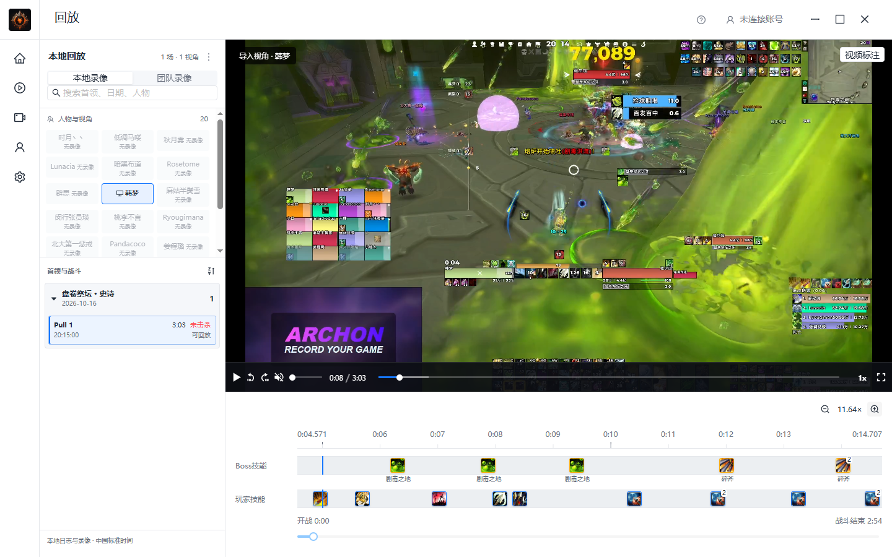

# Boss技能、技能ID与可见时间窗验收

日期：2026-10-18，Asia/Shanghai。用户要求优先12.1史诗团本，检查ReviewTool的技能悬浮／Boss资料／缩放；随后明确右上当前时间与设置需要移除。本轮未使用superpower skills，未自动提交或推送。

## 当前结果

- 悬浮信息首先显示技能名称和真实技能ID，不再用“施法成功”作标题；分组包含多个技能时逐项保留各自ID与定位时间，放大后可分开查看。鼠标悬浮不改变视频位置。
- Boss图标下增加名称，悬浮可查看完整名称及ID。当前1166项技能、825张图片（810 JPEG／15 PNG）；原1036项样本覆盖保留，新增126项资料。
- 指定日志共176种已观测敌方施法均有真实图片，其中史诗盘卷祭坛22次战斗的50种优先完成。其余来自已有英雄团本和大秘境样本；不能据此声称12.1全团本所有史诗首领／未观测机制已完整覆盖。正式盘魂者录像原缺少的13种Boss施法已包含。
- 右上当前时间和外观设置按用户澄清移除，保留缩放操作。
- 取消固定4倍上限，采用可见时间窗；拖动标尺／底部范围条、普通滚轮平移，Ctrl加滚轮围绕鼠标位置缩放，按钮优先围绕当前画面缩放。最细窗口为日志精度1毫秒，不宣称数学意义无限放大；可在整场真实范围内连续浏览。
- 秒刻度按绝对战斗时间对齐，足够放大时每秒显示数字，更细窗口显示毫秒。只绘制可见事件和标签，长战斗不会生成巨幅画布。名称和计数角标也不撑出边缘。

## REA对照

复用此前同身份ReviewTool.gg 1.0.14的REA证据及已核验提取文件，未执行目标脚本或访问其登录／业务数据。`08raUO4R.js` SHA256为 `ae126c9330d138ff4ffe045c4b0cf1eada3c1eaf331a8550f962c70adaa4b4be`；证据父ID为 `ev_9e9561c21b907c9533bc1a5ca2f7258e1ddcbb8afd45e09ed72cbcdb0a53f9ac`。

UTF-16偏移40493为遭遇技能配置，160109处按abilityGameID取得技能资料，162058处提供Copy Spell ID，165539起为按技能／来源与时间处理标记的Us函数。说明技能身份与资料驱动展示是明确依据；“施法成功”并不是技能身份。所检查主回放源没有足够证据证明存在用户所说的无限缩放，因此本项目可见时间窗是按本次明确需求实现，不冒称竞品完全相同。

## 资料来源及保护

只读扫描授权的WoWCombatLog-101626_200443.txt、WoWCombatLog-101626_223453.txt及既有正式录制对应的WoWCombatLog-101726_171833.txt。沿用生产解析器的敌对NPC／载具标志和战斗边界，保留首领、难度、场次数、技能ID／中文名、文件大小及SHA；不从同名或职业猜测技能。

固定SpellMisc映射为12.1.5.70391，优先难度16，再用通用条目；文件名来自已验证清单。69张新JPEG按明确映射下载；5项失败按FileDataID从本机固定12.1.5.70448 CASC提取，原始BLP内容MD5与固定清单一致，保留PNG原始解码及摘要。原玩家映射与新Boss映射无冲突。没有修改原日志、原片或扩大运行时网络源。

随包 `boss-abilities.json` 保存176项映射及来源，原 `source-map.json` 的1036样本清单不覆盖，另加bossCoverage。`manifest.json`包含829个发行资源摘要，重复执行merge-boss-resources.py后831个资源目录文件逐字节相同。初始资料中原有一张未引用图片保留，未擅自清理。

合并命令：`python client/tests/merge-boss-resources.py --audit <TEMP>/wow-boss-timeline-20261018 --spellmisc <既有固定CSV> --listfile <既有已验证清单> --resources client/src-tauri/resources/game-data`。先运行原玩家资料构建器，再合并Boss资料；不能仅运行旧构建器就宣称重建了新增Boss部分。原始审计和下载在TEMP，随包保留必要来源摘要，不提交完整日志或工具二进制。

## 已执行验证

| 命令／入口 | 实际结果 |
| --- | --- |
| client下npm run test:replay | 42通过、0失败，退出0；含所有资源摘要、176项Boss映射、M样本与原玩家覆盖 |
| node --test tests/timeline-viewport.test.cjs | 5通过、0失败，退出0；256倍、极端有限倍率、首尾边界、真实秒网格、毫秒端点及末端标签空间 |
| cargo test recording::playback::preferences::tests --lib | 8通过、0失败、120过滤，退出0；含高倍率持久化及NaN／无穷／低于1拒绝 |
| 临时verify-skill-viewport.cjs | 6项通过，退出0；M图标／名称、本人ID悬浮、Ctrl滚轮36.60倍、标尺拖动不seek、视频定位、两窗口长轴滚轮及范围条抵达终点；页面和控制台错误空 |
| native-boss-timeline.cjs | 真实Rust／WebView2三项通过，退出0；176项原生资料、128张不同图标本地协议200及实际解码／摘要一致，真实史诗HLS及ID，11.64倍缩放重启恢复；无CDN请求、pageErrors空、强杀0 |
| 原始输入保护 | 原生验收的源索引、原片及HLS共50个文件前后SHA相同；独立验收AppData新建且正常退出后清理，不操作正式应用 |
| npm run tauri -- build --debug --no-bundle | 正式标识开发构建退出0；验证配置构建也退出0。Vite仅包体积提示，Rust仅既有未使用diagnostics提示 |
| 正式开发产物清单 | 标识恢复com.wow.recorder，无验收标识；829项资源大小／SHA及NOTICE与源完全相同 |

原生命令使用显式 `--exe <独立标识构建的冻结副本> --index <既有M录像索引> --output <TEMP>/wow-boss-timeline-20261018/native-complete --playwright <既有playwright-core>`；测试在启动前检查二进制包含独立标识，拒绝覆盖已有验收目录。一次启动前保护曾拒绝非验收标识产物，没有启动正式应用；改为构建完成后立即冻结独立EXE再验收，最终三项通过。恢复正式构建后不启动正式用户应用。

最新证据：TEMP的 `wow-boss-timeline-20261018/native-complete/report.json`、`formal-debug-build.json`、`boss-inventory.json`、`icon-downloads.json`、`casc-extraction.json`；浏览器为 `wow-skill-viewport-browser-20261018/complete/report.json`。原生还验证悬浮不移动时间窗、Boss文字／计数不撑宽、放大后的时间标签不重叠。最终正式开发产物大小／SHA以前述formal-debug-build.json为准，前端Dc8CbCKD／mO3WRDja；没有用旧构建摘要代替本轮产物。

最终正式开发EXE冻结快照为30607360字节，SHA256 `57dd6692a21567b82070def268ed3fa20396b432c71b0be000f1bda265d312f9`，并验证包含当前前端资产名；829项打包资源及NOTICE与源码逐字节一致。冻结副本只用于产物身份核对，不冒充已经部署或打包的新安装器。

## 尚未覆盖

未观测的其他史诗首领／热修技能仍需对应资料和日志独立核对；未知图片显示真实ID，不伪造已覆盖。浏览器长时窗口使用明确合成媒体，真实M录像来自既有只读历史，不冒充本轮重新采集。未重新验证WHEP、远程WCL或所有硬件／安装矩阵；NSIS安装包未重打，旧安装包不包含本轮增量。本轮未提交／推送，最后执行git diff --check检查格式。
