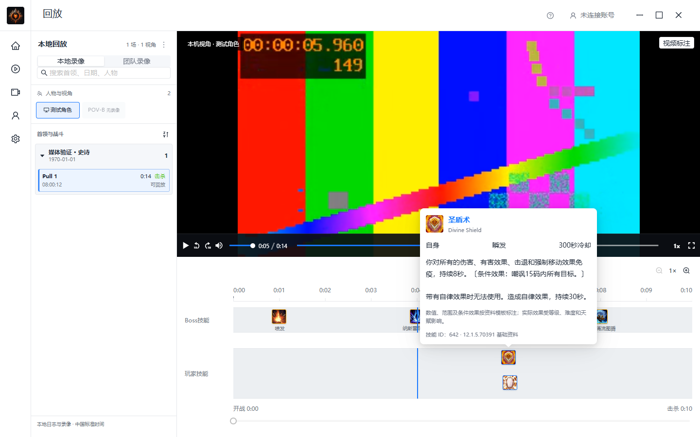
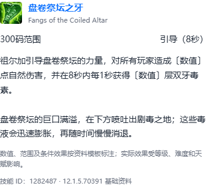
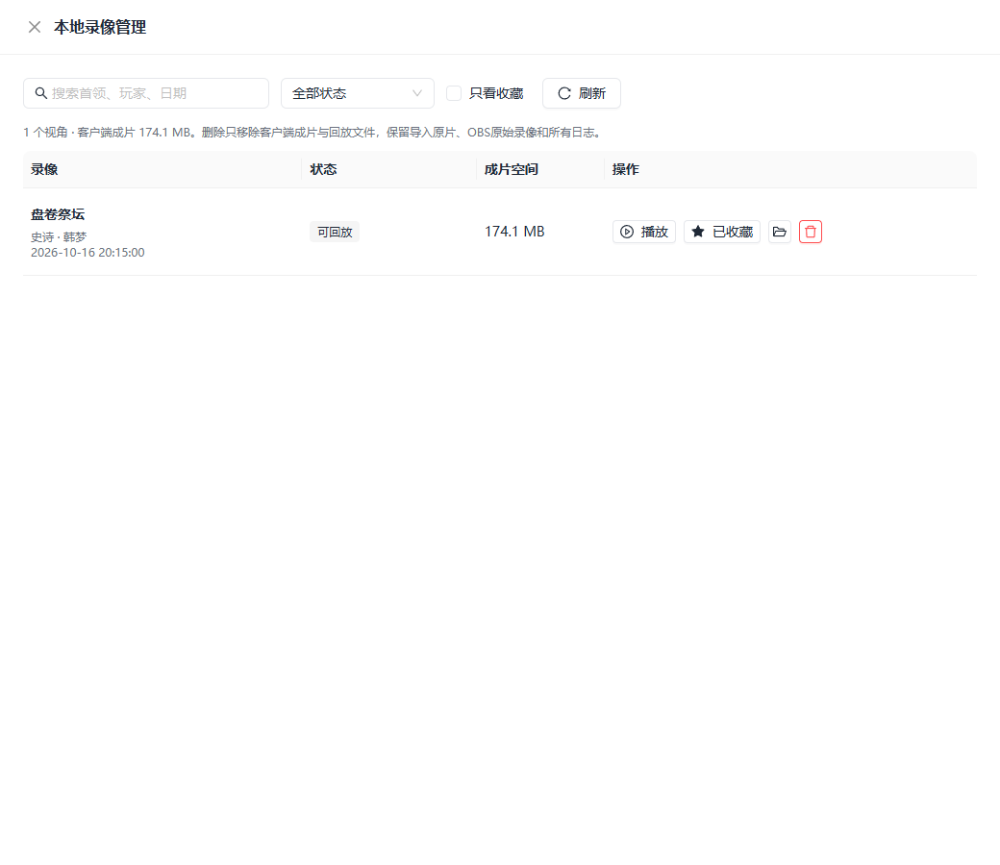

# 客户端技能详情、时间轴间距与录像管理验收

## 本轮结果

- 时间轴默认每秒64px、图标30px、单排52px、两轨间距32px；相邻不同技能换排，只有同技能／同真实来源／同类型才合并。玩家仍只显示当前录像视角身份，不包含团队施法。
- 标尺与轨道悬停显示秒及毫秒，悬停不改变媒体。点击标尺或轨道按真实战斗时间定位；拖动标尺平移，Ctrl滚轮缩放，底部范围条浏览长战斗。高倍毫秒首尾标签额外留白，修复本轮原生检查发现的重叠。
- Boss与玩家使用同一真实技能说明卡，显示图标、中英名、说明及已知范围／基础施法／冷却，ID和构建只作辅助。不再显示混合技能的施法成功流水。
- 左栏更多操作新增本地录像管理，支持搜索、状态和收藏筛选、播放、收藏、打开成片目录及确认删除。收藏由Rust LocalStateStore的recordingManagement区段保存，不使用localStorage。
- 删除仅限客户端成片与派生HLS，保留导入原片、OBS源录像、日志和旁车资料。拒绝活动／处理态、未结束上传、原片共享引用、外部路径、符号链接与Windows联接；常规保存失败回滚媒体和索引。

## REA对照与资料边界

沿用已核验ReviewTool.gg 1.0.14安装包／ASAR的静态提取证据，没有运行未知提取代码。包身份与前轮报告一致：EXE SHA256为`2e2a770518a193d14002d375ea3d8420eed741fea4804573313b7f8e5a5e3a7a`，ASAR为`66c34fa3224924bbd80ccc873fb73393fe1af9d36b7fd37913e8334f31bd71c3`。

`_app/immutable/chunks/08raUO4R.js`的Fi（UTF-16偏移64961）、hi（55624）和_i（55865）设置`data-wowhead="spell=..."`并调用Wowhead Tooltip刷新；完整说明卡来自该集成。Us（165539）按技能、来源与范围分组，不能据此证明竞品“无限缩放”或本项目的具体像素尺寸。证据索引位于临时rea-reviewtool-timeline-20261016/source-index.json，原始证据ID为`ev_9e9561c21b907c9533bc1a5ca2f7258e1ddcbb8afd45e09ed72cbcdb0a53f9ac`。本项目使用自身Ant Design主题和离线纯文本，不加载第三方Tooltip脚本。

说明来自Wago公开固定构建12.1.5.70391的9张CSV，1157／1166项有说明，1002项含明确动态／条件提示。Boss覆盖169／176，盘卷祭坛史诗48／50；后者缺“出生”41600与“恐惧哀嚎”1308011，源表无说明，界面明确提示缺失。伤害／治疗等动态值使用占位，不猜当前角色、天赋、史诗难度或热修数值。图标覆盖与说明覆盖分开计算。

来源、原始模板样本、各CSV大小及SHA、输入和生成器摘要见随包spell-tooltips-source.json；离线生成器client/tests/game-data/build-spell-tooltips.py只读取显式CSV目录。独立目录重建两份JSON逐字节一致。原始日志未包含精确构建号，固定资料不冒充日志当时的热修。

## 实际验证

命令均从client目录执行，Rust命令从client/src-tauri执行。浏览器边界为真实React／HLS.js与合成H.264/AAC，Tauri IPC明确使用夹具；原生则使用真实Rust、WebView2、本地协议与既有史诗战斗HLS的隔离副本。

| 命令／检查 | 结果 |
| --- | --- |
| npm run test:replay | 42通过，0失败，退出0 |
| node --test tests/timeline-viewport.test.cjs tests/spell-tooltips.test.cjs tests/runtime-assets.test.cjs | 14通过，0失败，退出0；其中5项资源检查与上行重叠 |
| cargo test --lib | 130通过，0失败，4辅助测试忽略，退出0 |
| cargo test recording::management --lib | 6通过，0失败，128过滤，退出0；属于上行子集 |
| node tests/browser-replay-library.cjs --fixture <既有合成夹具> --output <隔离输出> --playwright <现有playwright-core> | 8组通过，pageErrors及consoleErrors为空，退出0 |
| node tests/native-replay-library.cjs --exe <独立标识冻结EXE> --index <只读既有索引> --output <隔离输出> --playwright <现有playwright-core> | 7组通过，pageErrors／远程图标请求为空，强杀0，退出0 |
| npm run tauri -- build --debug --no-bundle --config <独立标识配置> | 退出0，冻结副本用于原生验收 |
| git -c core.whitespace=cr-at-eol diff --cached --check | 各批退出0；随包JSON按资源规则保留CRLF，默认check将新增CR视为尾随空白，使用单次命令参数识别CRLF，不修改Git配置或资源摘要 |
| npm run tauri -- build --debug --no-bundle | 正式开发构建退出0 |
| npm run tauri -- build | Release／NSIS构建退出0，没有安装或启动正式应用 |

浏览器检查逐秒展开、悬停不跳转、点击标尺实际完成媒体seek、Boss与玩家说明、1440×900／1080×720无横向溢出、管理搜索／收藏／目录IPC、取消删除、删除后空态、错误恢复与处理态禁用。

原生独立标识为com.wow.recorder.replaylibraryvalidation20261018，使用全新Roaming／Local目录。验证176项Boss资料及128张独立本地图标解码、真实史诗HLS与技能说明、精确8.756秒定位、11.64倍缩放及重启恢复、收藏跨重启、UI删除副本HLS后保留原片和旁车SHA、目录刷新及再次重启不恢复已删索引。50份受保护的源索引／原片／HLS摘要不变，验收AppData已清理；没有删除真实成片、修改原始日志或启动正式用户应用。

最新临时报告：wow-replay-library-20261018/browser-acceptance/report.json及native-acceptance/report.json。初轮脚本将战斗时间直接当视频时间、统计Antd测量行、忽略按钮自动空格，均修正了测试口径；旁车保留核验以目录正常升级后、删除前的SHA为基准。本轮原生标签重叠属于实际产品问题，已修复并补回归。

## 限制

不把历史实战回放当成本轮新录制或全史诗首领覆盖。原生删除验证针对隔离副本；真实资源始终只读。打开目录完成IPC与路径边界验证，未做资源管理器窗口的视觉验收。强杀／断电时暂存删除事务尚无自动恢复保证，异常目录保守拒删；不提供云端删除、批量清理或自动保留策略。本轮不扩展Web、WHEP长时、数据库或依赖。

正式开发构建与Release分别为30838784／21824000字节，两套均嵌入index-DuRi_Iyz.js，各831项资源及NOTICE与源一致。NSIS安装包125414735字节，SHA256为`87df8a68b685f976253f263b8b05dd5ad6ff8977058d060c32d04962abf4879a`；详细摘要位于临时wow-replay-library-20261018/build-artifacts.json。未执行安装／卸载或启动正式应用。
