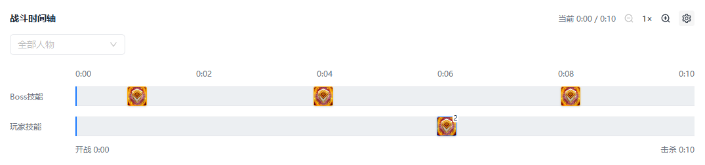
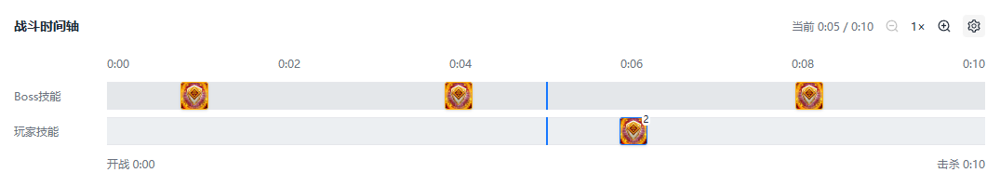
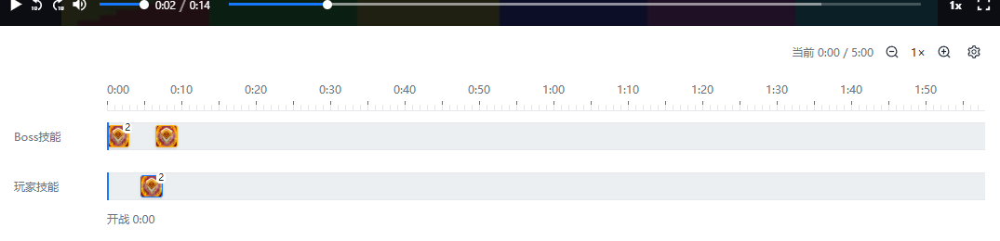

# 客户端时间轴轨道间距修复验收

日期：2026-10-18，Asia/Shanghai。

## 现象、根因与修改

Boss技能与玩家技能两行背景相接。`.replay-tracks` 只有组外边距，没有行间距，浏览器实际测得两轨边界距离为0px。默认30px行高、80%图标比例时，相邻图标仅约6px留白；100%比例时图标会贴边，计数角标进一步加重拥挤。

只修改 `client/src/pages/replay/replay.css` 的轨道容器：使用Grid，行间距16px，组上下外边距从8px改为12px。不改行高偏好、不重设用户配置，不改变时间位置或图标分组算法。此样式由客户端回放与直播回看共用。

这次修复依据本项目的实际浏览器尺寸，并非声称已测得ReviewTool运行界面的相同像素。此前REA提取的包内代码不足以证明其当前可见轨道的最终计算样式。

## 实际验证

- 在 `client` 执行 `npm run build`，退出0，TypeScript及Vite完成，仅有包体积提示。
- 用既有浏览器IPC夹具加载实际构建页面及H264／AAC媒体，临时补入明确标记的合成Boss施法事件，不修改真实录像或正式状态。
- 使用本机Edge无头浏览器检查1440×900、1080×720两个视口，各自检查20／30／50px轨高和100%图标比例，共6组。通过界面控件调整尺寸并等待弹层关闭后测量和截图。
- 修复前各组间距0px；修复后各组间距16px，实际轨高符合设置，未发生页面横向溢出。页面异常与控制台错误均为空，6组通过。
- 同时确认页面只有两条轨道，“导入技能资料”“轨道布局”“死亡明细”按钮不可见。未重跑旧28组全量浏览器矩阵或原生桌面验收。
- 最终执行 `git diff --check` 检查差异格式。

复现使用系统TEMP的 `wow-timeline-spacing-20261018/verify-spacing.cjs`，参数为 `--fixture <该目录>/fixture --output <该目录>/after --playwright <已缓存的playwright-core目录>`；脚本退出0，测量见 `after/report.json`。修改前证据见 `before/report.json`。TEMP资料不随Git同步。

截图为实际客户端网页，使用明确的合成媒体／事件夹具，图标按100%比例展示，不冒充真实首领战或ReviewTool截图。

## 边界

此次只验证浏览器样式及尺寸，不代表原生WebView2或直播WHEP场景完成验收；NSIS未重新打包，已安装客户端需更新构建后才会包含修复。未提交或推送Git，保留其他已有修改。

## 后续调整：精简工具条并将间距收至8px

同日用户继续要求隐藏录像信息、右侧图标、对齐微调和人物筛选，并核对ReviewTool间距。上文16px为前一次修改，当前最终值改为8px。

### ReviewTool源码对照

复用此前REA提取并与安装包清单核对一致的1.0.14源码，未重新执行目标应用：

- `_app/immutable/chunks/C_Gj17VL.js` SHA256为 `6501daec80e645c79554329f16fd47f0177ddd6a2e72ff3b74ee7a96dd547ba2`。UTF-16偏移3933处默认轨高30，4025处默认比例80，5149处按轨高乘比例计算图标尺寸，因此默认图标24px。
- `_app/immutable/chunks/08raUO4R.js` SHA256为 `ae126c9330d138ff4ffe045c4b0cf1eada3c1eaf331a8550f962c70adaa4b4be`。180872处时间轴模板使用flex纵向排列，没有额外gap；188625处逐轨设置高度，189419处玩家来源轨道使用边线分隔。
- 由此可得所检查源码默认额外轨间距为0，普通相邻图标约6px留白；玩家轨道还有边线。不能将前一轮本项目16px称为竞品值，也不能将源码默认值冒充用户当前配置下的运行测量。
- 本项目按此次需求将16px收为8px，默认两图标间约14px，保持两类轨道清楚分隔。这是本项目的样式选择，不声称完全复刻竞品像素。

### 本次修改及验证

- ReplayPage移除录像信息工具条、状态说明、其右侧全屏按钮及ReplayCalibration挂载。失败重试移到提示区；原有映射、错误提示及T全屏快捷键保留。
- EventTimeline移除人物筛选及旧actorGuid显示过滤，保留两条技能轴、缩放和外观设置。LivePage同步隐藏对齐微调和相关说明，保留真实战斗选择。
- `npm run build`退出0，TypeScript／Vite完成，仅有大包提示。当前前端构建为 `index-B_WhlEeV.js`／`index-BRDQo88Z.css`。
- 临时脚本 `wow-timeline-spacing-20261018/verify-simplified.cjs` 使用同目录fixture及已有playwright-core运行，退出0；结果 `simplified/report.json`。1440×900及1080×720、20／30／50px轨高、100%图标共6组全部为8px，无横向溢出、pageErrors或consoleErrors。
- 启动夹具特意保存不匹配人物的旧筛选及光环事件类型偏好，仍显示3个Boss图标和1组玩家图标；验证只有两轨，录像信息、工作台全屏按钮、对齐微调及人物筛选不可见。逐组点击战斗轴5秒，原生HTML视频定位到映射后的7秒，误差小于0.15秒；该容差是测试断言，不是跨设备同步精度。
- 浏览器使用明确的合成媒体／事件及Tauri IPC夹具，不能代替原生WebView2／WHEP验收；未重包NSIS。`git diff --check`退出0。

## 后续修正：玩家技能跟随当前录像角色

用户明确玩家技能只应展示当前录像角色，例如法师视角只显示该法师的技能，不能罗列全体玩家。此前合并 `owner=player` 和 `owner=team` 是该问题根因，现只取 `player`。

身份判断沿用已有事实：本地 `recording/events/parser.rs` 根据录像角色GUID（缺省时CombatLog本人标志）标记事件；云端 `wcl/query.py` 按当前recordingId读取显式actor绑定，`wcl/normalization.py` 标记本人事件。因此无需按职业或名字猜测，也不需要增加人物选择器。切换录像后消费该视角自己的事件快照，缺少本人事件时不回退全团队。Boss轨道、事件原始数据及8px间距不变，直播回看共用同一组件。

本轮验证：

- 修改前使用实际构建页面，明确复现玩家轨道含队友施法，包括队友对本人施法。
- 修改后使用本机Edge、已有IPC边界与合成媒体，3项通过：只显示本人并排除队友对本人施法；切换同场另一视角同步更新本人技能、Boss图标不变；本人事件缺失时玩家轨道为空而非回退全部队友。
- 页面异常及控制台错误为空，脚本退出0。证据位于TEMP的 `wow-current-pov-20261018/before/report.json`、`after/report.json`；命令为 `node <该目录>/verify-current-pov.cjs --fixture <该目录>/fixture --output <该目录>/after --playwright <已缓存playwright-core目录>`，修改前另加 `--baseline`。
- `npm run build`退出0，TypeScript及Vite完成，仅包体积提示；前端为 `index-CHNCOCPG.js`／`index-BRDQo88Z.css`。`git diff --check`检查格式。
- 此证据是受控浏览器回归，不代表新完成WCL远程导入、多人实拍或原生WHEP验收。未重包NSIS，未提交／推送。

## 最新：24px轨距与逐秒标尺

用户截图再次反馈紧凑、缺少每秒刻度，并要求删除“战斗时间轴”文案。当前最终间距改为24px，前文8px和16px均为历史；标题已从可见界面移除。

原界面只把时长六等分，产生0:56等标签，并把整场压入一屏。新增客户端 `TimelineRuler.tsx`，通过重复背景绘制每秒短刻度和每5秒长刻度，实际测量宽度后按至少64px标签距离选择整秒间隔，保留零点和终点，避免文字重叠。每秒至少8px，长战斗在轴内部滚动，缩放时秒宽同步增长；不创建逐秒DOM，时间及事件坐标仍使用同一战斗相对时间。

继续核对REA提取的ReviewTool同版本08ra源码，`nc`按毫秒显示悬停时间，但本轮证据不足以证明竞品具有完全相同的逐秒标尺；新标尺按用户需求实现，不宣称竞品像素或交互一致。

验证结果：

- `npm run build`退出0，TypeScript／Vite完成，保留大包提示；当前为 `index--8jAAcio.js`／`index-BLCTpGtp.css`。
- Edge实际网页使用明确合成媒体及IPC夹具，1440×900／1080×720、0／10／113.5／300秒、1×／4×共16组通过。验证24px轨距、每秒至少8px乘缩放、重复背景周期与每秒坐标一致、首尾时间正确、标签不重叠、标题不可见、页面不横向溢出；300秒会在时间轴内滚动。
- 当前视角3项回归重新执行并通过，排除队友、视角切换及缺失本人时不回退全团队保持正确。两套报告的pageErrors及consoleErrors均为空。
- 命令：`node <TEMP>/wow-timeline-ruler-20261018/verify-ruler.cjs --fixture <TEMP>/wow-current-pov-20261018/fixture --output <TEMP>/wow-timeline-ruler-20261018/after --playwright <既有playwright-core目录>`；当前视角回归使用前轮 `verify-current-pov.cjs`，输出到新目录的 `pov-regression`，两者退出0。
- 长时夹具只延长事件轴时长，实际合成媒体仍为短片；用于标尺几何检查，不冒充5分钟完整媒体或现场采集。未重跑原生WebView2／WHEP，也未重包安装包。`git diff --check`检查格式。

