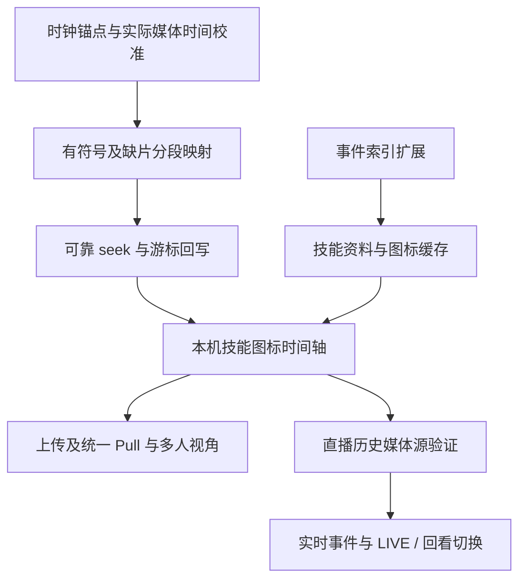

# 当前录制回放对照 ReviewTool 的缺口与实施方案

分析日期：2026-10-16（Asia/Shanghai）。依据当前工作区代码、产品文档及 `reviewtool-timeline-seek.md`。本文件是待实施方案，不代表相关能力已完成或已通过运行验证。

后续已细化为 [完整实施方案](../plans/2026-10-16-replay-implementation.md)，包含数据契约、接口、目录落点、迁移及工作包。具体开发拆分以该文档为入口，本文件保留现状证据与缺口分析。

本文能力对照是首批代码实现前的审计快照；最新实施状态以完整方案顶部进度为准。原录制编排与处理代码已按 capture／processing 迁移，下方代码依据使用新路径。

## 1. 结论与范围

当前已完成本机单视角的基础闭环：OBS 持续录像 → CombatLog 识别 Boss Pull → 保留前后各 5 秒 → 分割源文件 → FFmpeg 无重新编码成片 → CMAF/fMP4 HLS → 点击战斗时间轴定位。

要接近 ReviewTool，优先补齐准确时间映射、完整事件和技能图标、可靠的播放控制。多人视角需要新增云端关联和上传链路；直播中回看过去需要新增持续历史媒体源，二者不能靠完善当前时间轴界面自动获得。

继续使用 Rust／Tauri、React、Ant Design、Media Chrome 和 hls.js。没有发现必须更换为 Electron／Svelte 才能实现目标的技术障碍。

本方案覆盖三种效果：

- 第一阶段：本机已结束录像的技能图标、事件跳转、流畅游标和准确定位。
- 第二阶段：同一 Pull 多人视角切换，保持战斗时间。
- 第三阶段：直播仍在进行时向过去拖动，再返回实时画面。

## 2. 当前能力与缺口清单

| 能力 | 当前代码事实 | 缺少内容 | 优先级 |
| --- | --- | --- | --- |
| 自动录像与单场成片 | 已有持续录像、Pull 状态机、尾帧、分割、恢复和严格解码校验 | 连续真实样本中的时序与恢复验证、失败任务重试入口 | 第一阶段 |
| 已结束录像回放 | 已有最终 MP4 转 VOD HLS、受限本地协议、Media Chrome 控件 | 无需重新建设播放器基础框架 | 保留 |
| 点击战斗轴／技能定位 | 已有 `video.currentTime = pullTime + videoZeroMs` | 请求裁切点与实际媒体起点校准、符号和缺片区间、seek 完成保护 | 第一阶段最高 |
| 媒体／日志时间映射 | 依赖 OBS 事件接收时间或文件创建时间、源文件墙钟范围 | 录制时钟锚点、实际媒体包时间戳、校准来源与可信度 | 第一阶段最高 |
| 技能事件 | 敌对 Creature／Vehicle 施法开始和成功；本机玩家施法成功 | 死亡、团队成员技能、Buff／Debuff、打断、驱散、目标身份和机制筛选 | 第一阶段 |
| 技能图标 | 只有日志技能 ID 和名称，界面是窄色块 | 技能资料表、图标来源、缓存、缺图回退、图标交互 | 第一阶段 |
| 时间轴体验 | 点击轴、悬停基本说明、两条轨道、`timeupdate` 回写游标 | 拖动预览与提交、图标避让、筛选、平滑游标、事件前文 | 第一阶段 |
| 回放状态恢复 | 回放状态在页面组件内部，页面导航会卸载 | 应用级当前 Pull／视角／战斗时间和偏好恢复 | 第一阶段 |
| 多人视角 | 左栏只有本机录像，Pull ID 含本地日志文件身份 | 团队统一 Pull、角色与录像关联、每路映射、上传、云端处理、成员选择 | 第二阶段 |
| 直播期间回看 | 只有 WHEP 实时播放；MediaMTX HLS 和 playback 关闭 | 持续历史分片、可回看区间、实时事件、LIVE／回看切源 | 第三阶段 |

“Boss 技能”当前实际包含符合敌对标志的 Creature／Vehicle 施法，不能直接当作已筛选的 Boss 关键机制列表。读取参战角色集合也不等于已经索引全团技能。

## 3. 第一阶段：先让本机录像复盘准确、完整

### 3.1 校准时间映射

当前 `coordinator.rs` 用墙钟重叠区间推算 `videoZeroMs`；`processor.rs` 用输入端 `-ss`、`-c copy` 和 `-avoid_negative_ts make_zero` 裁切。最终媒体起点可能落在请求点之前的可定位位置，不能直接假设请求起点就是视频第一帧的绝对时间。FFmpeg 官方明确说明，输入端 seek 配合 stream copy 会保留最近 seek 点到目标之间的额外片段。[FFmpeg 文档](https://ffmpeg.org/ffmpeg.html#Main-options)

实施内容：

1. 录制期间建立同一次采样的 Unix 毫秒／进程单调时钟／OBS 输出进度关联，记录启动、分割、重连和暂停边界；记录查询往返时间及锚点不确定度。OBS 事件到达时间、文件创建时间保留为辅助信息。
2. 使用媒体探测读取源文件、每个裁切段和最终成片的时间基、首个可显示帧时间、关键帧及实际时长，追踪裁切与拼接后的时间戳变换。当前随包只有 FFmpeg，没有发现 ffprobe；实施时需选择增加受管 ffprobe 或用已有媒体库探测，补充相应资源校验，不能假设工具已存在。[ffprobe 文档](https://ffmpeg.org/ffprobe.html)
3. 媒体探测只能校正媒体坐标，不能单独恢复日志与录像墙钟的关系；还需要录制锚点，并用可识别的真实画面／日志事件验证编码及采集延迟。
4. 连续且完整的录像先采用有符号偏移，`scale` 默认 1；只有多个独立锚点表明存在持续漂移时才估计比例，不从单一开战点拟合漂移。
5. 分别保存原始锚点、自动校准和用户微调。用户微调通过 Rust `LocalStateStore` 的回放业务区段保存，生效时明确显示校准来源与质量；不使用前端 localStorage。
6. 明确业务时间与 HLS 媒体时间之间的变换。先检查本项目 fMP4 的实际时间原点，再决定是否补偿，避免照搬 ReviewTool 的 MPEG-TS 首片 `deltaPTS` 修正而重复加偏移。

建议业务契约：

```text
pullTimeMs：以开战为 0 的业务时间
logicalVideoMs = scale × pullTimeMs + offsetMs
mediaTimeMs：播放器实际使用的媒体时间，由媒体适配层换算
```

偏移必须允许负值。例如开战后第 10 秒才开始录像，战斗第 30 秒对应视频第 20 秒。当前无符号 `videoZeroMs` 把负偏移压成 0，只能依靠 partial 禁用战斗轴避免错误，不能支持完整缺片定位。

### 3.2 为缺片保存分段映射

当前映射只有 `hasGap`，多个源段经 concat 后缺失的墙钟时间会被压缩。单个偏移无法正确描述缺口后的所有位置。

每个有效区间需要记录战斗起止、输出视频起止及映射来源。点击时先查目标是否落在有效区间，再计算视频位置；目标在缺口内时显示“该时段没有录像”，允许选择前后有效区间。反向回写游标也使用同一份区间映射。

例如战斗 40～45 秒缺片，不能把拼接后视频第 45 秒继续解释为战斗第 45 秒。保留当前缺片提示，待分段映射验证后再开放有效区间的技能跳转。

### 3.3 补齐事件契约与索引

Rust 先扩展稳定事件契约，至少保留：事件 ID、Pull 时间、类型、来源 GUID、目标 GUID、技能 ID、技能名及必要的叠层／额外技能字段。当前事件没有来源 GUID 和目标身份，单靠名字不足以区分同名人物、技能目标和召唤物。

按使用价值分批索引：

| 顺序 | 事件 | 用途 |
| --- | --- | --- |
| 1 | 死亡、本人／团队关键技能施法 | 一键复盘、个人和团队减伤轨道 |
| 2 | Buff／Debuff 应用、移除、叠层 | 机制点名、减伤覆盖、目标筛选 |
| 3 | 打断、驱散及关联技能 | 关键处理复盘 |
| 4 | Boss 阶段及机制配置 | 从全部敌对施法中筛选重要机制 |

不同日志事件的字段布局分别解析，不复用施法字段下标猜测死亡、光环和驱散数据。保留未知与解析失败统计，避免当前逐行忽略错误后仍显示完整索引的情况。新增索引版本并支持基于现存日志重建；旧日志已不存在时明确提示，不能伪造缺失事件。

完整伤害／治疗分析不作为图标时间轴的前置条件。先完成关键事件，避免大量普通技能、周期伤害占满 UI。

### 3.4 建立技能资料和图标缓存

建议将技能资料与发生事件分开：

```text
事件：某角色在某时刻使用 spellId
技能资料：gameVersion + spellId + locale → 名称、图标、分类
```

本地日志继续提供即时名称；已缓存的技能资料提供图标。云端接入后，可用 WCL 报告技能资料或 `GameAbility` 补充技能图标字段，客户端只消费统一资料，避免依赖 WCL 原始响应。[WCL GameAbility](https://www.warcraftlogs.com/v2-api-docs/warcraft/gameability.doc.html)、[WCL ReportAbility](https://tw.warcraftlogs.com/v2-api-docs/warcraft/reportability.doc.html)

图标由 Rust 或后端适配器下载和缓存，再通过受控资源地址提供；限定图片来源，缓存命中时离线可用。资料未就绪显示技能名和占位图，不阻塞视频。若要求首次安装且完全离线也有图标，需要单独准备随包技能资料与图片，不能承诺网络缓存覆盖未知技能。

Wowhead 只提供可选法术外链和提示，不参与事件时间与录像定位。首期可直接使用 Ant Design Tooltip 显示本地资料，外部提示不可用不影响核心交互。

### 3.5 统一播放控制与时间轴交互

在回放领域内集中处理业务时间与播放器操作，不再由多个组件直接改 currentTime：

- 统一 `seekToPullTime`、事件跳转、进度回写和未来视角切换入口。
- 源加载期间保存待跳转目标，等待 metadata 和可播放范围可用后提交；通过请求序号使最后一次点击生效，忽略旧源或旧 seek 的迟到回调。
- seek 尚未完成时，避免旧播放进度把用户刚选择的战斗时间覆盖回去；读取实际完成位置并处理范围不足。
- 平滑游标优先使用 `requestVideoFrameCallback`，不支持时回退到播放期间的 `requestAnimationFrame`／现有媒体事件。不会通过固定 25 毫秒定时器承诺帧级准确。[浏览器视频帧回调说明](https://developer.mozilla.org/en-US/docs/Web/API/HTMLVideoElement/requestVideoFrameCallback)
- 将色块改为技能图片；增加图标边缘约束、重叠合并／避让、点击弹层及按人物／技能／类型筛选。避让只改变显示坐标，跳转保留原始事件时间。
- 空白轴支持指针拖动，拖动中预览战斗时间，松开后提交；鼠标、触摸和键盘交互使用一致边界。
- 普通轴点击定位到所选时刻；技能回看可默认提前 3 秒，死亡可进入更长前文窗口，预览时间与事件发生时间分别展示。提前量进入项目配置。
- 回放的当前 Pull、战斗时间、选中人物及筛选提升到应用级回放 Provider，避免导航卸载后归零；用户恢复偏好经 Rust LocalStateStore 保存，实际媒体连接和解码状态重新检测。
- 加载、无事件、缺图、缺片、播放失败均有独立展示，不能因为图标请求失败禁用整段录像。

### 3.6 恢复与处理耗时

保留现有严格解码校验。先分别统计等待尾帧、源文件关闭、裁切、解码校验和 HLS 生成的耗时，再决定是否优化；当前整段解码完成之前不能保证迅速进入 ready。

增加失败任务的可定位诊断和用户重试入口；重试保留稳定 Pull ID，复用已验证产物，避免重复生成多份目录。检查长战斗、快速连续 Pull、跨源文件、OBS 退出、日志轮转和磁盘不足。

## 4. 第二阶段：多人视角与云端数据

当前目录只有客户端和文档，没有已实现的 `backend/`、`web/` 云端应用；不能把架构文档中的 PostgreSQL、上传和 WCL 适配当成现有功能。

需要按依赖顺序增加：

1. 平台登录、团队权限、活动和统一 Pull 身份。本地 `stable_pull_id` 包含本地日志路径／文件身份，继续用于本地幂等，但不能作为多人共用 Pull ID。
2. 视频与元数据的受控上传、可恢复队列、对象校验、服务端处理状态、CMAF/fMP4 HLS 产物和授权播放地址。
3. 云端将成员本地 Pull 关联到团队 Pull。按团队、Encounter、难度、时间、持续时间和角色／共同事件验证关联，存在歧义时标记待确认，不能只按同一 Boss 和近似开战时间合并。
4. 按较新上下文采用 Archon 上传 CombatLog、云端在 WCL Report 可用后导入的路线，建立 report/fight/角色关联、revision 更新、分页、授权及失败恢复。本地轻量事件与标准事件保留来源和稳定关联，增强时去重替换，避免一场技能出现两次。
5. 为每路录像建立经过验证的分段时间映射、校准质量和覆盖区间。成员列表只开放覆盖目标时间且可播放的录像。
6. 切换成员时保留统一 Pull 时间、暂停／播放、倍速和音量；新源可定位后恢复。只加载当前视角，可按需预取候选清单，不预加载全团视频。

代码依然只需要一个实际播放中的视频。全团事件和多路录像属于统一业务数据，不要求同时播放多路画面。

## 5. 第三阶段：直播中回看过去

### 5.1 新增历史媒体源

当前 HLS 只在 Pull 结束并生成最终 MP4 后产生；直播模型只有会话 ID、开始时间、录像状态和 ICE 信息。它既不暴露历史范围，也没有 LIVE／回看状态。

建议先验证有限窗口的本机 DVR：OBS 同一发布源经 MediaMTX 同时提供 WHEP 实时画面和持续 HLS 历史窗口；OBS 原有高质量录像继续作为正式资产。已锁定的 MediaMTX 1.18.2 提供 HLS 常驻生成、分片数量和落盘目录配置，但当前项目明确关闭了这些能力。[1.18.2 原始配置](https://raw.githubusercontent.com/bluenviron/mediamtx/v1.18.2/mediamtx.yml)

这会扩展当前“本机 HLS 不参与直播”的架构约束。实施这个阶段时需同步更新直播架构与配置；本轮没有开启服务、修改端口或运行配置。

先验证以下事项，再选正式参数：

- HLS 必须从开播时持续生成，不能等第一次点回看才开始保留历史。
- 按实际码率、磁盘和关键帧间隔确定回看窗口；UI 展示真实可用范围，不把“分片数 × 目标片长”当作精确边界。
- 验证当前直播 Opus 音频与视频编码在 MediaMTX、hls.js 和 WebView2 中的完整兼容性，不能因为 WHEP 可播就认为 HLS 一定可播。
- 建立服务端或媒体层的墙钟／PTS 锚点，与业务 Pull 时间对齐；会话开始时间本身不足以校准视频内容。
- 若只需当前进程中的短时回看，可使用滚动窗口；若要求整场活动历史或退出后继续回看，需要持久化分片目录、索引、清理和历史清单。这是额外能力，单纯加大播放器 backBufferLength 不成立。
- MediaMTX 录制／playback 服务与 HLS 是不同接口，不能默认开启 playback 就获得 HLS 清单；如采用归档录制方案，需要明确媒体封装和播放适配。

### 5.2 持续事件与 LIVE／回看切换

当前活跃 Pull 的事件为空，索引依赖结束时间和日志结束位置。直播时间轴需要从现有增量读取器持续提取关键事件，发布活动 Pull、时长及可回放范围；不能等结束后重读整个区间才显示事件。

播放器状态至少区分实时、历史加载、历史回看和返回实时。向过去跳时，将 Pull 时间映射到当前 HLS 窗口；返回实时使用实际直播边缘和可配置阈值，不能硬编码照搬 ReviewTool 的 8 秒。

切换时保持音量和播放意图，避免双路同时出声；冻结旧画面或显示加载遮罩，等目标源出现有效画面再完成切换；切换后释放不用的连接。正在回看的区间被窗口淘汰时明确提示并提供可用位置。

停止直播后，滚动历史源与最终高质量 Pull HLS 的时间映射分别验证，再按统一战斗时间切换。MediaMTX 临时历史分片不能直接覆盖正式录像元数据。

## 6. 实施顺序与验收



| 交付顺序 | 可见结果 | 必须验证的内容 |
| --- | --- | --- |
| 1. 准确定位 | 当前色块事件也能可靠跳到正确画面 | 开头、中段、结尾的日志／画面锚点；非关键帧裁切；首片时间原点；负偏移；跨源与中间缺片 |
| 2. 图标与事件 | Boss／个人／关键团队技能、死亡、光环可筛选查看 | 真实日志字段、同名角色、重复事件、图标缺失和离线命中；图标避让不影响跳转 |
| 3. 交互与恢复 | 拖轴、事件前文、顺滑游标、跨页面保持进度 | 连续快速 seek、加载期间点击、旧回调、暂停／倍速、首尾越界、错误与重试 |
| 4. 多人复盘 | 两路真实录像在同一战斗时间切换 | 时钟偏差、不同预留画面、缺片、无视频成员、上传中断、权限和同 Boss 相邻 Pull 区分 |
| 5. 直播回看 | 直播中拖到历史，再返回实时 | 从开播即保留历史、真实 seekable 范围、音视频兼容、窗口淘汰、重连与磁盘清理 |

第一阶段可先以正常连续录像的事件画面误差不超过 500 毫秒作为候选验收目标，记录典型值、最差值和异常原因；这是待用户确认及样本验证的目标，不是当前能力声明。跨视角、冷加载等待及直播切源耗时另行测量，不能把轮询周期当成定位精度。

## 7. 模块边界与兼容性

- `recording/mod.rs` 当前 496 行，混有状态、日志轮询、源文件管理、任务编排；`processor.rs` 498 行，混有媒体处理、目录迁移、旁车元数据。录制根目录已有 10 个 Rust 文件。新增能力前应按源文件／时钟采集、成片处理、事件索引、回放访问评估领域拆分，入口只负责组合，避免继续堆入接近 500 行的大文件。
- 复用现有 `recording/playback/` 的播放访问边界；时间映射归属录制领域，技能资料作为独立资料能力。页面组件消费业务契约，不依赖 OBS 和媒体运行时配置。
- 回放控制器属于回放业务，已有实时与历史两个真实媒体消费者时再抽取共同接口；不提前建设支持任意播放器的插件框架。
- 前端继续通过 Tauri command 获取业务数据，恢复偏好由 Rust LocalStateStore 管理；连接、录制和实时进度启动后重新检测。
- 扩展索引／旁车数据时明确 schema 版本和旧数据迁移。旧记录缺媒体锚点时标为粗略对齐，可保留原回放但不声称已精确校准。
- 调整关键帧间隔需要单独验证编码器负载、码率和媒体兼容性；`hls_time=4` 与 `independent_segments` 标签不会自动插入关键帧，也不能消除既有 stream-copy 起点偏差。

## 8. 文档口径与待确定事项

`CLAUDE.md`、`PRODUCT.md` 中仍有全员完整 CombatLog 上传和 WCL 非核心的旧描述；`.agents/CONTEXT.md` 后段已记录 Archon 上传、WCL 云端标准事件的较新决定。`LIVE_ARCHITECTURE.md` 声明保存单调时钟原点，而当前录制模型只持久化墙钟；代码中的 `Instant` 主要用于轮转／超时，没有形成可恢复媒体映射锚点。

本方案依据较新的 Archon／WCL 方向安排未来云端链路，同时明确本地轻量事件可独立工作。正式实施前应统一对应文档。直播 DVR 的保留时长、是否跨重启保留、图标首次离线覆盖，以及最终误差阈值尚未确定；本轮不把这些建议写成已接受的产品要求。

## 9. 代码依据与本轮验证

| 路径 | 定位 | 说明 |
| --- | --- | --- |
| `client/src-tauri/src/recording/processing/mapping.rs` | `map_clip_sources` | 原墙钟裁切范围与缺片检测；新代码已保留有符号偏移 |
| `client/src-tauri/src/recording/processing/command.rs`、`processing/clip.rs` | `build_slice_args`、`process_clip` | stream copy、拼接、全片解码、随后生成 HLS |
| `client/src-tauri/src/recording/playback/hls.rs` | `build_hls_args` | 最终 MP4 转 VOD fMP4 HLS，目标分片 4 秒 |
| `client/src-tauri/src/obs/runtime/service.rs` | 录制事件监听与文件发现 | OBS 事件接收墙钟、文件创建时间作为源锚点 |
| `client/src-tauri/src/recording/events/parser.rs`、`events/index.rs` | `parse_event`、`populate_missing_timelines` | 原 timeline.rs 已迁移；本表描述的是实施前事件范围，新增能力见实施进度 |
| `client/src-tauri/src/recording/pull_tracker.rs` | `stable_pull_id` | Pull ID 含本地日志身份，活跃 Pull 事件初始为空 |
| `client/src/pages/replay/ReplayPage.tsx` | `handleTimeChange` | 直接写 currentTime，切 Pull 清零，partial 禁用战斗轴 |
| `client/src/pages/replay/components/HlsVideo.tsx` | HLS effect 与 `onTimeUpdate` | 基础加载、致命错误反馈，无待 seek 与时间原点适配 |
| `client/src/pages/replay/timeline/TimelineTrack.tsx` | `TimelineTrack` | 原组件已迁移；两轨色块是实施前状态，当前为多轨真图标和分组 |
| `client/src/app/App.tsx` | 页面组合 | 直播页常驻，回放页导航卸载 |
| `client/src-tauri/src/live/runtime/config.rs` | `runtime_config_content` | 当前 `hls: false`、`playback: false` |

本轮只执行文档／代码读取、`rg`／`rg --files` 搜索、只读目录及行数核对，并查询 FFmpeg、MediaMTX 固定版本配置、WCL 和浏览器官方资料。WCL 部分详情页打开失败，图标字段依据官方搜索索引可见内容，未验证认证请求或可用配额。

差异检查：`git diff --check` 退出码 0；对本报告及当月历史分别执行 `git diff --no-index --check -- NUL <文件>`，退出码均为 1（未跟踪文件与空文件存在差异），没有空白错误诊断，仅有 LF／CRLF 转换提示。

未运行项目测试、lint、TypeScript、Cargo、构建、媒体处理命令或目标应用；未修改业务代码、依赖、运行配置和现有录像。本方案的定位精度与性能仍需按第 6 节用真实媒体验证。
