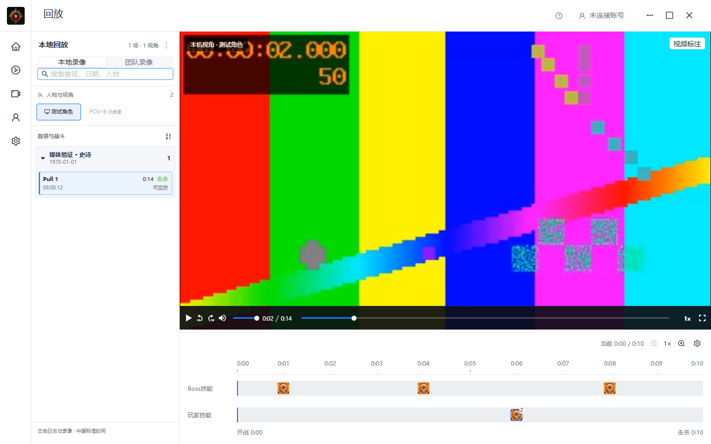

# ReviewTool 回放能力对照与客户端范围建议

日期：2026-10-18，Asia/Shanghai。本次仅分析，不修改客户端功能，不删除已有分析模块。

## 结论

按当前“单场当前视角录制、视频与时间轴回放”的目标，客户端已经具备核心闭环。主要差距集中在技能筛选、录像管理和精细播放交互。死亡伤害、治疗、血量、减伤与耗材分析超出当前主线，建议撤下主要入口，保留死亡时间标记和点击定位视频。

需要纠正此前表述：撤下的是本轮未交付的新分析扩展和独立死亡控件，旧死亡分析并未整体移除。当前界面仍可打开“死亡复盘”。本报告是精简建议，不代表已执行隐藏或删除。

## 能力对照

| 能力 | ReviewTool 静态证据 | 当前客户端 | 建议 |
| --- | --- | --- | --- |
| 视频、事件时间轴、点击定位 | 播放器与 Pull 时间映射、事件定位 | 已实现，已有实际单场录制回放证据 | 保留核心主线 |
| 按技能搜索、逐项显隐、首领预设 | selectedAbilityIds、spellSearchSelectedAbilityIds、预设及保存逻辑 | 已有事件类型、人物筛选和自定义移轨，但缺少完整技能选择器及预设闭环 | 优先补齐技能搜索与显隐，预设随后 |
| 逐帧与画中画 | 暂停时前后帧操作；画中画按浏览器能力启用 | 没有对应播放控件 | 第二优先；Tauri/WebView2需单独验证能力 |
| 临时加速 | 按住鼠标临时提高倍速，松开恢复 | 已有普通倍速，缺少此交互 | 可选，优先级低于基本操作 |
| 录像收藏、删除、容量管理 | 云端 VOD 收藏、日期／类型筛选、单条及批量删除、配额和自动淘汰 | 已有列表筛选；收藏字段尚无操作闭环，本地删除与保留策略缺少用户入口 | 优先补本地收藏、受保护删除及容量提示；自动清理需明确规则 |
| 死亡后查看录像 | showDeath 跳到死前3秒；有明确角色用户映射时切到死者视角 | 普通死亡事件当前使用死前15秒定位；另有分析面板 | 保留轻量导航；没有死者录像时保留当前视角，不伪造切换 |
| 当前视角／指定玩家轨道 | current-pov 与指定玩家轨道、增删及保存 | 人物筛选、归属与技能移轨已有，但不等同于完整的动态玩家轨道 | 单视角暂不扩展复杂编辑，保留简单筛选 |
| 多视角保持战斗位置 | 切换POV保留Pull相对时间 | 已实现对应映射和缺口拒绝 | 多人实拍精度属于待验收，不是功能空白 |
| 直播回看与返回LIVE | WHEP实时、HLS历史及切换状态 | 已实现，并已有切换画面快照处理 | 不重复开发；继续验证长时与异常恢复 |
| 地下城组合轴／跨Pull连续VOD | combined／pull模式及绝对视频时间映射 | 当前以单场战斗为主 | 延后，不作为本轮缺口 |
| 外部视频与时间分享 | Twitch／YouTube适配、带时间点分享 | 客户端以本地及私有媒体为主；Web另有时间链接 | 延后，不作为本地单场播放前置条件 |
| 画面标注 | Fabric绘制及团队标记，部分能力受功能开关影响 | 已有共享标注编辑器 | 放入高级入口，当前无需继续扩展 |

ReviewTool 的录像管理证据来自远程 `/api/v1/vods`，不能据此宣称它支持本地文件删除或“打开文件夹”。客户端增加“打开所在文件夹”是本地产品易用性建议，不能冒充竞品已验证能力。

## 应精简的界面与职责

1. 从回放主工具栏及事件详情撤下死亡分析入口。当前 `client/src/pages/replay/timeline/EventTimeline.tsx` 有“死亡明细”，`TimelineEventDetails.tsx` 有“查看死亡明细”，`ReplayPage.tsx` 仍挂载 `DeathReviewPanel`，并非仅残留文件。
2. 死亡复盘面板中的伤害／治疗汇总、最后伤害、生命采样、减伤和耗材分类不属于当前播放器必需能力。相关实现位于 `client/src/pages/replay/review/`，全局 `DeathReviewProvider` 仍被 `client/src/app/App.tsx` 使用。以后若实施移除，应检查引用、状态与测试，不能只删除可见按钮就声称整套分析已去掉。
3. WCL导入、上传、团队协作及复杂轨道编辑可以收进“更多／高级”。这些功能服务后续多人云端场景，并非全部无用，但不应挤占本地播放主路径。
4. 日志索引、技能图片、时间映射、缺口保护、ffmpeg与ffprobe是正确播放和处理录像的基础，不建议作为冗余删除。

建议主界面保留：录像列表 → 播放器 → 战斗时间轴 → 人物／技能筛选。死亡与施法均作为时间轴标记，用于跳转画面。

## 建议实施顺序与验收

1. 精简主界面：撤下分析入口，保留普通事件定位。验收死亡点仍能跳转正确时间、普通播放和暂停行为不变。
2. 补技能筛选：搜索、逐项显隐和恢复默认，通过 Rust LocalStateStore 保存偏好。验收同名不同技能ID、未知技能、空结果与重启恢复，不修改原始事件。
3. 补本地录像操作：收藏、打开文件夹、明确确认的删除、容量提示。删除前界定受管理文件范围，保护导入源片；验收失败提示及索引一致性。收藏保留优先级与自动淘汰另行明确，不默认删除历史录像。
4. 补逐帧及能力允许的画中画：验收暂停帧、变帧率、片尾、音画状态及快捷键焦点。ReviewTool后退使用固定1/60秒，不能宣传为精确上一帧；本项目实现也必须准确说明能力。
5. 后续再决定多人轨道、外部平台及组合时间轴。多人实拍同步、硬件长录、磁盘异常和安装发行是验收矩阵，不混写成尚未实现的播放器功能。

未在本次证据中确认 ReviewTool 提供 A–B循环、剪辑导出、悬停缩略图、截图导出或多音轨选择，故不将这些列为对标必补。客户端MP4可能保留多音轨而HLS使用首音轨，是自身已知限制，但竞品是否提供选择没有足够证据。

## REA 证据与边界

目标：本机 `ReviewTool.gg` 1.0.14，Electron + Svelte；播放器使用 HTMLVideoElement／hls.js。技术栈差异不构成能力缺口，不建议为对标替换本项目 React／Tauri。

- EXE SHA256：`2e2a770518a193d14002d375ea3d8420eed741fea4804573313b7f8e5a5e3a7a`。
- app.asar SHA256：`66c34fa3224924bbd80ccc873fb73393fe1af9d36b7fd37913e8334f31bd71c3`。
- 本轮重新核对安装文件身份，与前次分析相同；8项提取文件摘要与本轮ASAR清单对应项一致。
- 使用 [reverse-engineer-anything 技能](C:/Users/Admin/.agents/skills/reverse-engineer-anything/SKILL.md)，REA CLI 6.5.0 的 `analyze-javascript-application`，指定包内源路径、JSON输出。未执行目标脚本、未登录或调用目标远程业务接口。
- 既有播放器证据：`ev_9e9561c21b907c9533bc1a5ca2f7258e1ddcbb8afd45e09ed72cbcdb0a53f9ac`；UI辅助证据：`ev_049160f79224ff3676c1d355da7b55e0df54b40dcbc2fe4f03891065b0c5b23d`。
- 新补充分析：`ev_9c2192f5a5f7b2b53cbb87618ec8059a5a7bc76daa6ba1210199e1cc4d49220d`，3份JS解析、0解析失败；录像库分析：`ev_9e6a343356edb1fb2dad4bac27f2955a9dd5d1a4e943ba19dcd36b1ff4f75e5d`，2份JS解析、0解析失败。两条CLI均退出0。
- 原始证据保存在系统TEMP的 `rea-reviewtool-timeline-20261016` 与 `rea-reviewtool-comparison-20261018`，后者含 `analysis-summary.json`。TEMP并非随Git持久化证据；本报告保留摘要、方法定位和身份，不提交巨大打包源码。

主要包内定位（偏移为UTF-16字符区间，右端不包含）：

| 包内源 | 方法／范围 | 支持结论 |
| --- | --- | --- |
| `_app/immutable/chunks/08raUO4R.js` | Fr.showDeath `[29408,29564)` | 死前3秒及有绑定时选择死者POV |
| 同上 | Fr.selectUserPov `[30807,31165)` | 保留Pull内时间 |
| 同上 | ni.setAbilitySelected `[37868,38106)`；setSpellSearchAbilitySelected `[38106,38426)` | 技能选择与保存 |
| 同上 | ri.addCurrentPovTimelineBar `[42968,43176)` | 当前视角动态轨道 |
| `_app/immutable/chunks/B-T5_GYl.js` | Qd.skipFrameBackward `[527917,528064)`；skipFrame `[528064,528206)` | 后退1/60秒；前进结合视频帧回调暂停 |
| 同上 | Qd.togglePictureInPicture `[531457,531704)` | 能力检测后的画中画 |
| 同上 | Qd.startPlaybackRateHold `[522997,523349)` | 按住临时倍速 |
| `_app/immutable/nodes/18.DC1N4aZB.js` | 收藏、日期筛选、删除确认和配额界面 | 云端录像库交互 |
| `_app/immutable/chunks/BZqDrR60.js` | `/api/v1/vods` 查询及收藏／删除／配额请求 | 云端录像库数据操作 |

当前代码核对重点：`ReplayPlayer.tsx` 的 MediaChrome 控件、`useReplayPlayback.ts` 的切换与偏好、`EventTimeline.tsx` 的筛选及分析入口、`review/DeathReviewPanel.tsx` 的分析组合、`recordingService.ts` 的操作接口、`recording/model.rs` 的收藏字段、`LiveMediaPlayer.tsx` 的过渡画面快照。

静态解析图不完整；未选中的源文件、动态功能开关、服务端实现及实际账号权益不能从本轮代码断言。showDeath证明所检查回放路径是导航，不证明整个ReviewTool产品完全没有其他分析。未运行本项目测试或构建，本次仅做REA、源码对照和文档差异检查。

## 后续：截图右上角工具栏对照

用户提供当前客户端顶部截图，要求检查与ReviewTool是否相同、缺哪些。本轮只分析，不调整界面。前文的技能轨道、分析入口等部分结论已有后续实施，以PRODUCT、HANDOFF及client-timeline-spacing-validation-2026-10-18.md最新节为准。

### 对照结论

不是同一布局：当前 `ReplayHeader.tsx` 在视频上方排列上传、导入、全目录录像下拉、刷新、结果和媒体状态，第二行显示日期及成片时长。所检查ReviewTool回放模板中，报告／日期／场次在左侧栏或Electron标题栏槽位，媒体来源、分享、绘制、设置、工作台全屏及战斗时长排列在时间轴右侧竖向操作栏。不能把这些侧栏能力说成竞品“右上角按钮”。

| 项目 | 当前实现与差异 | 性质与建议 |
| --- | --- | --- |
| 控件高度 | 实际网页中上传／导入24px，下拉／刷新32px，状态标签22px | 明确样式不统一；统一一档尺寸即可，不涉及新功能 |
| 录像下拉 | 212px实际可见宽度内包含完整日期、Boss及状态，截图已截断；左侧已有日期、首领和视角选择 | 展示重复，属于布局精简项；可移入更多或改为简短当前场次，勿重复列全目录 |
| 上传／导入／刷新 | 本地文件管理入口放在主要回放操作位置 | 项目自有能力，不是竞品回放页已确认的对应按钮；可保留能力并收进更多 |
| 已击杀／可回放 | 分别表示战斗结果和媒体状态，不是同一事实；正常状态同时使用亮标签显得拥挤 | 可弱化正常状态、突出失败／处理中；不能为了精简混淆结果与媒体状态 |
| 窄窗口状态 | 1080px视口下“可回放”标签实际尺寸0×0，CSS在1180px以下隐藏最后标签 | 响应式取舍不合理，建议改成不丢失异常状态的摘要 |
| 右下时长 | 当前调用recordingDurationSeconds，优先取成片媒体时长；竞品操作栏使用当前Pull时长，地下城组合模式则为整段遭遇时长 | 时长语义不同；截图4:53应理解为成片时长，不能直接当战斗时长。若都保留，应明确区分并减少与播放器时长重复 |
| 带时间分享 | 竞品复制链接携带报告、遭遇、Pull、人物及当前时间；客户端回放目录未发现对应入口 | 确实缺少桌面时间点分享闭环，但属于后续协作能力，本地单场无需优先补 |
| 媒体平台选择 | 竞品可在当前人物可用来源中切Peek／Twitch／YouTube | 客户端本地／私有媒体场景没有相同来源选择；属于范围差异，可延后 |
| 标注／设置／全屏 | 客户端已有视频标注、时间轴外观、播放器全屏及T工作台快捷键；摆放与竞品不同 | 不是功能缺失。用户已要求隐藏工作台全屏图标与对齐入口，不能再擅自恢复 |

建议先做顶部去重、尺寸统一、状态及时间语义澄清。无需为了对标把分享、第三方平台、死亡分析或已隐藏的工具全部补到右上角。

### REA来源与实际检查

复用前述相同身份ASAR的播放器证据 `ev_9e9561c21b907c9533bc1a5ca2f7258e1ddcbb8afd45e09ed72cbcdb0a53f9ac`，本轮继续读取已核验摘要的包内源，不重新执行目标脚本或调用业务接口。

`_app/immutable/chunks/08raUO4R.js` 中UTF-16偏移：Iu左栏／Electron标题栏245390，Ud媒体来源288874，Zd分享293778，viewer-actions模板296194，cf组合296772，时长输出302876。模板中viewer-actions使用flex-col，并依次组合媒体来源、分享、可选绘制、设置、全屏和时长；分享函数调用Uu及clipboard，绘制仍受功能开关影响。`_app/immutable/nodes/9.racUq0ps.js` 使用headerInTitleBar参数，说明Web与Electron头部呈现存在分支。

当前项目检查 `ReplayHeader.tsx`、`ReplayCloudUploadButton.tsx`、`ReplayPlayer.tsx`、`model.ts` 及replay.css。上传禁用已有Tooltip原因，截图灰态不等于上传坏了；团队标准事件入口仅团队来源显示，不能由本地截图断言缺失。

使用本机Edge加载当前构建，Tauri IPC和媒体为明确夹具，1440×900及1080×720两次检查退出0，pageErrors／consoleErrors为空，无整页横向溢出；真实测量控件高度、下拉文本和窄屏标签隐藏。临时脚本及报告在TEMP的 `wow-replay-header-audit-20261018/inspect-header.cjs` 和 `after/report.json`。本轮未执行测试矩阵或构建、未修改业务源码、未重包NSIS、未提交／推送。

这些证据足以确认模板分区和当前客户端样式差异，不代表已启动登录ReviewTool、量取其运行界面像素，亦不证明所有账号和功能开关下布局完全一致。

## 后续实施：移除重复顶部栏，管理操作收进左栏

用户已要求按上述对照精简。删除ReplayHeader及专属CSS，不再显示视频上方重复标题／日期、全目录下拉、正常状态标签及额外成片时长。场次和视角集中左栏，成片时长使用播放器，战斗时长使用时间轴。

新增ReplayActions组合既有上传、标准事件、导入和刷新入口，由ReplayPage注入左栏。管理按钮在“更多录像操作”展开后显示并统一28px；空列表可导入，刷新不重建播放器。导入点击后关闭更多但独立Drawer继续显示；上传与标准事件沿用原业务组件，保留原禁用／身份／团队权限和确认流程。按钮样式只作用菜单直接子项，避免污染上传对话框。

实测发现更多按钮Tooltip挡住数据源切换，已移除额外Tooltip层并使用原生title；不使用强制点击绕过遮挡。保留错误提示、失败重试、本人技能范围、逐秒标尺、24px轨距及播放器操作。没有擅自新增分享、第三方视频或恢复死亡／校准入口。

验证：最终在client执行 `npm run build` 退出0，TypeScript／Vite完成，仅大包提示；当前前端 `index-CkZTZyMT.js`／`index-BYwPEK0d.css`。Edge真实网页、明确合成媒体及IPC边界下，8项通过：两种窗口无顶部重复UI／页面溢出且管理项同高，刷新保留媒体元素，更多导入完成，失败重试，空目录导入，夹具身份下上传选择与确认，团队标准事件Drawer。当前视角3项回归另行通过，两套报告pageErrors／consoleErrors均空。

检查脚本最初未等待弹层动画并直接操作隐藏的Segmented原生input，已改为等待显示／关闭及点击可见标签，最终高度使用offsetHeight避免动画变换干扰；真实Tooltip遮挡则修改源代码后复验。截图等待媒体帧就绪，避免将加载中黑屏当成交付效果。

临时证据在 `wow-replay-simplified-layout-20261018/after/report.json`、`pov-regression/report.json`、`verify-layout.cjs`、`verify-pov.cjs`，两脚本均使用 `--fixture <TEMP>/wow-current-pov-20261018/fixture --output <对应输出目录> --playwright <既有playwright-core目录>`，最终退出0。夹具账号／队列计数不代表真实远程上传或WCL导入验收；未重跑原生WebView2／WHEP、未重包NSIS。`git diff --check`检查格式，未提交／推送。

