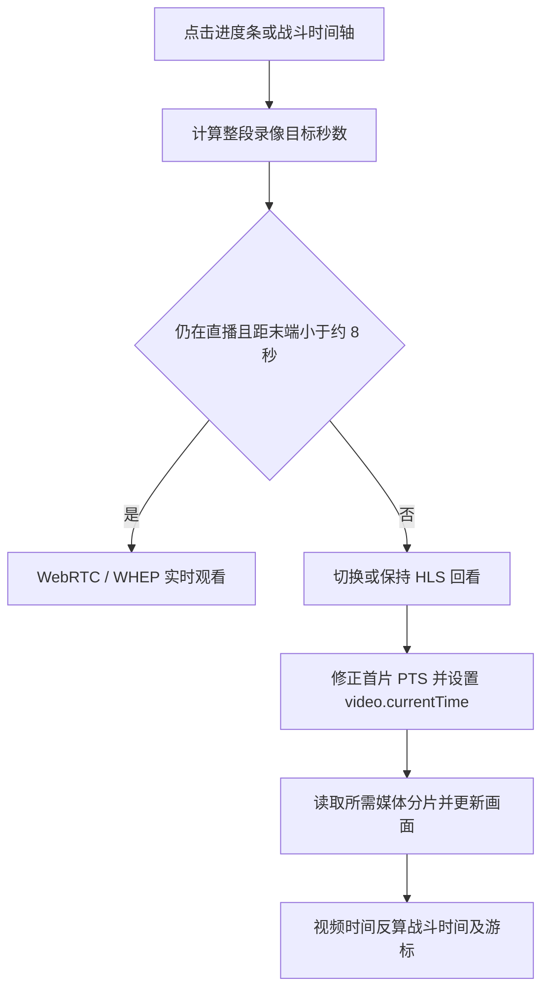

# ReviewTool.gg 直播回看与时间轴定位分析

分析日期：2026-10-16（Asia/Shanghai）。使用 REA 6.5.0 对用户指定的已安装程序进行静态分析，辅以提取文件的语法树定位和代码阅读。本轮没有启动目标、请求目标服务器或修改程序。

## 结论

ReviewTool.gg 的 Peek 播放器把实时观看和历史回看分成两种模式：实时观看使用 WebRTC/WHEP；向过去跳转时，切换到同一录像 ID 的 HLS 源，再设置 HTML 视频元素的播放位置。目标进入仍在直播录像的末端约 8 秒范围时，切回 WebRTC。

战斗时间轴通过报告、Pull 和录像的时间元数据计算跳转位置。核心公式为：

```text
战斗目标绝对时间毫秒 = report.startTime + pull.startTime + 战斗内目标毫秒
录像有效起始毫秒 = vod.startTime + (vod.offset || 0) × 1000
录像目标秒数 = (战斗目标绝对时间毫秒 - 录像有效起始毫秒) / 1000
媒体元素目标秒数 = 录像目标秒数 + fragStartOffset
```

`vod.offset` 是业务对齐校准量，单位为秒；`fragStartOffset` 是播放器根据 HLS 首片 PTS 数据得到的媒体时间修正量。两者属于不同层次，不能混为一个偏移。

## 样本与证据

| 项目 | 结果 |
| --- | --- |
| 用户指定入口 | `C:\Users\Admin\AppData\Local\Programs\ReviewTool.gg\ReviewTool.gg.exe` |
| EXE 长度 | 233055016 字节 |
| EXE SHA-256 | `2e2a770518a193d14002d375ea3d8420eed741fea4804573313b7f8e5a5e3a7a` |
| 包位置 | `resources/app.asar` |
| ASAR SHA-256 | `66c34fa3224924bbd80ccc873fb73393fe1af9d36b7fd37913e8334f31bd71c3` |
| 随包版本 | `1.0.14`，来自 `package.json` |
| 界面与播放器 | Electron、Svelte 前端、原生 video、随包 hls.js 1.6.16 |
| 应用资源 | ASAR 顶层文件树中有 309 个文件；含 `/streams`、`/viewer` 和 `/watch/[remoteId]` 路由代码 |

REA 证据保存在系统临时目录 `C:\Users\Admin\AppData\Local\Temp\rea-reviewtool-timeline-20261016`：

- `inventory-evidence.json`：`ev_7a708304bf0029b0ab6f45d15ce65b17ee17e6de589ec672540fe1d2fec977df`，先选择 `package.json` 建立包身份与完整目录身份。
- `extraction-evidence.json`：`ev_711291192b7b31289990b10f8580c955021ac8019fdf4173f3c1c5ec22b9c84a`，提取清单与逐文件摘要；未报告完整性矛盾。
- `playback-evidence.json`：`ev_9e9561c21b907c9533bc1a5ca2f7258e1ddcbb8afd45e09ed72cbcdb0a53f9ac`，7 个选定源文件的分析，其中 6 个 JavaScript 文件成功解析，解析失败数为 0。
- `playback-summary.json`、`source-index.json`、`static-verification.json`：精简摘要、语法范围索引和文件摘要核对结果。

REA 提取目录为 `C:\Users\Admin\AppData\Local\Temp\rea-extracted-7168bcb0-147f-478d-a66d-416176045d13`。临时目录可能被清理；需要长期保留原始证据时应保存完整目录。

两个主要文件的 SHA-256：

- `_app/immutable/chunks/B-T5_GYl.js`：`3299ea0d8a4846b72d2aec982b1066c802748ce25484e0a28dc8532a149d720f`，包含 Peek 播放器及 hls.js。
- `_app/immutable/chunks/08raUO4R.js`：`ae126c9330d138ff4ffe045c4b0cf1eada3c1eaf331a8550f962c70adaa4b4be`，包含战斗时间轴、录像映射、播放器适配和回写状态。

下文代码范围为 Babel AST 的 UTF-16 字符偏移，起点包含、终点不包含；不是文件字节偏移。压缩符号如 `Qd`、`Fr` 仅对这个构建有效。

## 播放器进度条如何定位

`B-T5_GYl.js` 中的 `kf` 是媒体进度条。处理过程为：

1. 通过 `getBoundingClientRect()` 获取进度条位置。
2. 将鼠标横坐标换成比例：`ratio = clamp((clientX - left) / width, 0, 1)`。
3. `pointerdown` 捕获指针，`pointermove` 更新拖动比例和悬停时间，松开时才提交 `seekTo(ratio * duration)`；`pointercancel` 也绑定到相同处理器。
4. `duration` 对已完成录像是 `(endTime - startTime) / 1000`；对仍在直播的录像按 `(Date.now() - startTime) / 1000` 更新。
5. LIVE 模式下进度条显示在 100%，VOD 模式按 `currentTime / duration` 显示。

这里的时间以整段录像开始为零，与战斗时间轴的 Pull 零点不同。

## 战斗时间轴如何定位

`08raUO4R.js` 的 `kc` 组件处理战斗时间轴。普通 Pull 视图中，点击位置先换算为百分比，再乘 Pull 时长，随后通过 Pull 的绝对起点减去录像有效起点，得到录像秒数，调用播放器管理器。

组合地城视图先把点击比例映射到整段地城时间，查找对应 Pull，再调用 `selectPull(encounterId, pullId, timeWithinPull)`，进入同一套录像时间映射。

例如：录像在开战前已经开始 50 秒，点击战斗第 30 秒，且 `vod.offset = +2` 秒，则录像逻辑位置为 `50 + 30 - 2 = 78` 秒。正偏移会增加录像有效起点，从而减小同一战斗时间对应的视频秒数。

技能和死亡标记调用 `showAbilityCast`、`showDeath`：先取 `max(0, event.timestamp - 3000)`，再选中 Pull 和相关人物视角。因此这些事件入口默认提前 3 秒展示上下文，并非精确跳到事件发生瞬间。

已追踪到的这条时间映射采用起始时间加固定偏移；没有在该客户端路径中看到对时钟漂移使用 `scale` 拟合的步骤。不能据此排除服务端对输入时间进行预处理。

## 从直播切到历史回看

`B-T5_GYl.js` 中 `Qd` 是 Peek 播放器状态及控制类；`Wd` 构造媒体地址：

```text
HLS：https://<shard>.peek.reviewtool.gg/<videoId>/index.m3u8
WHEP：https://<shard>.peek.reviewtool.gg/live/<videoId>/whep
```

`loadWebRTCStream` 创建 `RTCPeerConnection`，声明音视频 `recvonly`，将 SDP offer POST 到 WHEP 地址；收到轨道后将流交给 `video.srcObject`。

`seekTo(targetSeconds)` 的逻辑可以整理为：

```text
约束目标到 [0.1, duration - 0.1]
如果录像仍在直播，且目标 > duration - 8：
    恢复 1 倍速，切回 LIVE/WebRTC，销毁 HLS
否则：
    如果当前为 LIVE，则关闭 WebRTC，切换到 VOD
    从 LIVE 回看，或在支持 hls.js 的情况下向后跳：
        截取当前画面作为过渡，重建 HLS，并设置目标时间
    其他情况下：
        设置 video.currentTime = targetSeconds + fragStartOffset
```

8 秒来自该构建中的常量 `qd = 4`、`Jd = 2`。它是客户端的末端选择策略，不能单凭这两个数认定服务器分片时长一定为 4 秒。



在已追踪的跳转调用链中，目标秒数用于客户端播放器定位，没有看到每次点击都把目标时间提交给服务端临时剪辑的操作。HLS 源地址也没有因点击目标增加 start 参数。实际分片请求、缓存命中、服务端清单更新和媒体保留策略没有运行时证据。

## HLS 时间戳修正与过渡画面

`loadHls` 使用随包 hls.js；观察到的配置包括 `lowLatencyMode: false`、`maxBufferLength: 12`、`maxMaxBufferLength: 32` 和 `backBufferLength: 30`。这里的 30 秒是播放器已播放缓冲的配置，不能当成服务器只保留 30 秒历史内容。

进入 VOD 时监听 `LEVEL_PTS_UPDATED`，当分片相对地址为 `seg_000000.ts`，取 `deltaPTS ?? 0`：

```text
video.currentTime = initialTargetSeconds + deltaPTS
fragStartOffset = deltaPTS
```

对外读取当前播放时间时，VOD 模式返回 `video.currentTime - fragStartOffset`；LIVE 模式返回 `(Date.now() - startTime) / 1000`。应用层由此继续使用以录像起点为零的逻辑时间。

模式切换或向后定位前，播放器把当前 video 画面绘到 canvas，生成 JPEG 过渡图。`playing/canplay` 等事件停止缓冲提示，随后结合 `requestVideoFrameCallback` 和目标时间条件撤去过渡图。这可减少流切换时直接显示空画面的情况；实际视觉效果未运行验证。

## 时间轴如何跟随视频，以及视角如何切换

`08raUO4R.js` 的 `Md` 在播放开始后建立 25 毫秒轮询，读取当前播放器的逻辑秒数：

```text
当前绝对时间 = vod.startTime + vod.offset × 1000 + 当前录像秒数 × 1000
当前战斗内毫秒 = 当前绝对时间 - 当前 Pull 绝对起点
时间轴百分比 = 当前战斗内毫秒 / Pull 时长 × 100
```

`syncToAbsoluteVodTime` 还会按绝对时间查找对应 Pull；播放跨越 Pull 边界时可更新选中的战斗和游标。25 毫秒是代码中的调度间隔，不代表实际帧精度，也不代表服务器同步频率。

人物视角切换保留 `timeWithinPull`，再使用新人物录像的 `startTime/offset` 重新计算秒数。切换播放器来源时，`pendingAbsoluteVodTime` 暂存旧播放器的绝对时间，避免切换后直接回到录像零点。

`selectedVod` 会优先保留仍覆盖目标绝对时间的已加载录像，否则按人物、来源及时间覆盖范围选择录像；同一录像执行 seek，不同录像则加载新录像并传入目标秒数。不能只给所有视角设置同一个 `currentTime`。

播放器适配支持 Peek、Twitch、YouTube：分别调用自有 `seekTo`、Twitch `seek`、YouTube `seekTo`。Twitch 另有待跳转状态，误差小于 1 秒或超过 15 秒后解除，以避免异步 seek 尚未完成时旧位置回写时间轴；不能把这项保护概括为所有播放器统一采用相同机制。

界面还提供右键编辑 `Offset (seconds)` 的入口；应用先更新 `vod.offset`，再 POST `/api/v1/vodOffset/set/<id>` 保存。该样本明确存在人工校准能力；未从客户端证据取得服务端初始 offset 的自动计算算法。

## 关键定位表

| 随包文件 | 方法或组件 | UTF-16 范围 | 用途 |
| --- | --- | --- | --- |
| `B-T5_GYl.js` | `Qd.loadWebRTCStream` | `[524912,525952)` | WHEP 建链与 srcObject |
| `B-T5_GYl.js` | `Qd.loadHls` | `[525952,527711)` | 加载 HLS 与 deltaPTS 修正 |
| `B-T5_GYl.js` | `Qd.setVideoCurrentTime` | `[527711,527832)` | 写入原生 video.currentTime |
| `B-T5_GYl.js` | `Qd.seekTo` | `[528443,528881)` | 8 秒末端判断、LIVE/VOD 切换和定位 |
| `B-T5_GYl.js` | `Qd.getCurrentTime` | `[531704,531833)` | 统一播放器逻辑时间 |
| `08raUO4R.js` | `Or.getAbsolutePullTime` | `[20276,20413)` | 报告时间加 Pull 相对时间 |
| `08raUO4R.js` | `Nr.seekTo` | `[23309,23490)` | 三类播放器 seek 适配 |
| `08raUO4R.js` | `Fr.getVodStartTime` | `[27169,27225)` | 录像起点加业务 offset |
| `08raUO4R.js` | `Fr.getVodOffsetForPull` | `[27225,27376)` | 绝对时间转录像秒数 |
| `08raUO4R.js` | `Fr.syncToAbsoluteVodTime` | `[28738,29408)` | 视频时间回写战斗时间轴 |
| `08raUO4R.js` | `Fr.selectUserPov` | `[30807,31165)` | 保持战斗进度切换视角 |
| `08raUO4R.js` | `Fr.seekToTimeWithinPull` | `[32838,33137)` | 按目标时间 seek 或加载录像 |
| `08raUO4R.js` | `kc` | `[181801,191484)` | 时间轴坐标、普通 Pull 与组合地城视图 |
| `08raUO4R.js` | `Md` | `[285861,287662)` | 25 毫秒播放位置轮询 |

## 前端 UI 与技能图标补充研究

本节于 2026-10-16 补充。重新计算已安装 EXE 和 ASAR 的 SHA-256，均与上文相同，因此复用已有播放调用链证据。新增 REA 证据为 `ev_049160f79224ff3676c1d355da7b55e0df54b40dcbc2fe4f03891065b0c5b23d`，完整文件位于原证据目录的 `ui-evidence.json`；精简摘要为 `ui-summary-local.json`。以下区分发布包直接观察、基于组件结构的推断和仍未知的服务端行为。

### 前端技术与界面组成

| 层次 | 结论与证据 | 确定程度 |
| --- | --- | --- |
| 桌面容器 | Electron；已有 `playback-evidence.json` 包含 `main.js` 的 BrowserWindow 创建路径 | 静态确认 |
| 页面框架 | Svelte 5、SvelteKit；`P23wQyCs.js` 明确将 `5` 写入 Svelte 版本集合，路由包存在 SvelteKit 加载器和路由运行时；随包有对应许可证 | 静态确认 |
| 样式 | Tailwind CSS 工具类与 Svelte 组件 CSS；`0.DFUAQ4ES.css` 包含 `@layer utilities`、`--tw-*`，随包有 `tailwindcss`、`@tailwindcss/vite` 许可证 | 静态确认；未取得精确版本 |
| 弹层、选择器等基础交互 | Bits UI；相关代码使用 `data-bits-*`、`--bits-popover-*`、`--bits-tooltip-*`，随包有 `bits-ui` 许可证 | 静态确认 |
| 上层组件风格 | `data-slot`、`bg-background`、`border-input` 等结构与 shadcn-svelte 风格一致 | 推断；不能仅凭发布包认定原项目采用了某个 shadcn 模板或版本 |
| 普通操作图标 | Lucide Svelte SVG；`DotYsiog.js` 有 `lucide-context`、`lucide-icon` 和 SVG 渲染逻辑，随包有 `@lucide/svelte` 许可证 | 静态确认 |
| 魔兽技能图标 | 使用普通 ``，按技能数据的 `icon` 字段加载 RPGLogs 图片；与 Lucide 操作图标分开 | 静态确认 |

新增 REA 分析选择 `package.json` 和 `DotYsiog.js`、`CoObf7fi.js`、`CCRbbTEy.js`、`P23wQyCs.js`、`DThfxyQW.js` 五个 JavaScript 文件。UI 判断同时辅以已提取 CSS、许可证和原播放证据内的组件调用阅读；许可证存在本身不等于相关能力一定运行。本次对全部 309 个提取文件重新计算摘要，全部匹配 REA 提取清单，结果保存在 `ui-icons-verification.json`。

### 时间轴与技能标记如何绘制

普通 Pull 的技能轨道由 `08raUO4R.js` 中 `qs`、`Us`、`Ws`、`Vs` 协作实现：

1. 从 `pull.abilityCasts` 取事件，以 `abilityGameID` 识别技能；按已选技能、轨道、人物和当前视角筛选。
2. 以 `event.timestamp / pullDuration * 100` 得到横向百分比。
3. 用绝对定位的 DOM 容器和 `` 绘制图标，通过 `left: clamp(...)` 防止边缘图标超出轨道。所追踪的技能轨道并非 canvas 绘制。
4. 对靠得太近的图标做位置分离；部分非 `cast/begincast` 事件按技能、来源及组别，在 2 秒窗口内合并。图标位置因此可能有避让，跳转仍以原始事件时间为准。
5. 技能图标打开交互弹层，显示名称、事件类型、来源或目标及时间；弹层里的回看操作调用 `showAbilityCast` 或等价人物选择逻辑，通常跳到事件前约 3 秒并选择相关视角。不能把打开弹层等同于每次都立即 seek。
6. 技能可拖到其他轨道，载荷包含 `abilityGameID` 和事件 `type`；拖轨只改变显示归属，不改变技能发生时间。

播放器视频区域和战斗轴为应用自有组件组合；本节没有证据证明时间轴使用某个现成图表库。视频过渡画面使用 canvas，与技能轨道使用 DOM 不冲突。

### 技能名称、图标与事件从哪里来

客户端先按技能 ID 查询三类资料：当前 Encounter 配置、友方技能配置、报告内的技能表。`ri.getAbility` 的优先级为 Encounter → friendlyAbilityMap → reportAbilityMap，取到 `{name, icon}` 后绘制。

已观察到的图片地址规则为：

```text
普通魔兽技能：https://assets.rpglogs.com/img/warcraft/abilities/<icon>
死亡事件：按 killingAbilityGameID 查技能，再使用上述图片规则
未知技能图标名：inv_misc_questionmark.jpg
大秘境词缀：https://wow.zamimg.com/images/wow/icons/large/<icon>
```

其中 `<icon>` 是接口返回的文件名或图标字段，不能把数字 spellId 直接当成图片名。部分通用技能列表使用 `Ni`：如果字段已以 `http` 开头，则直接使用，否则补 RPGLogs 地址。

报告页 `9.racUq0ps.js` 通过 `/ws/reports` 建立连接，调用 `requestReport`，将返回的 `report` 与 `abilityConfig` 放入页面状态；需要技能事件时调用远端 `requestSpellData(fightId, abilities)`，再写入 Pull 的技能事件集合。由此可确认前端消费服务端提供的报告和事件；这不证明服务端内部如何访问 WCL、缓存技能或生成初始录像偏移。

此外还有：

- `api/v1/encounter-abilities/journal/<game>/raid/<boss>` 或 `dungeon/<instance>`：按团本 Boss 或地城提供 Encounter Journal 配置。
- `api/v1/ability-groups/<game>/hierarchy`：玩家职业／专精技能层级。
- `api/v1/user/encounter-settings/<game>/<encounter>`：用户选择、轨道归属和变体设置。
- 根布局加载 Wowhead 的 `tooltips.js`，技能链接设置 `data-wowhead="spell=<id>"`，并支持刷新 Tooltip 和打开对应法术页。Wowhead 提示脚本与 RPGLogs 技能图片是不同资源来源。

这些地址均来自随包静态代码，本轮没有实际请求。

### 支持显示哪些技能图标

界面可选择 Boss／小怪机制、职业／专精技能、技能预设和当前报告内搜索到的法术；也支持当前视角或指定玩家技能轨道。实际名称与数量由报告、Encounter 配置、职业专精和用户选择共同决定，无法只靠当前安装包列出所有技能名称和图片。

已观察到配置接受的事件类型包括：`cast`、`begincast`、`applybuff`、`applybuffstack`、`removebuff`、`applydebuff`、`applydebuffstack`、`removedebuff`。死亡另外显示死亡标记与致死技能。配置还包含坦克／治疗／伤害机制、可打断和驱散类型标签；这些标签不能证明独立的打断、驱散事件轨道已实现。

随包图片清单中另有坦克、治疗、伤害职责图标，以及圆圈、叉、菱形、月亮、骷髅、方块、星星、三角八种团队标记。`images/` 的八张团队标记位于 `drawing/wow/raid/`，属于标注资源，不能当作技能图库。完整 309 文件提取清单没有提供可离线枚举的全量魔兽技能图片库。

### 补充定位与验证

下表沿用上文 Babel AST 的 UTF-16 范围；来自原播放证据及只读语法索引。

| 随包文件 | 位置 | UTF-16 范围 | 用途 |
| --- | --- | --- | --- |
| `08raUO4R.js` | `Fr.showAbilityCast` | `[29564,29726)` | 事件前 3 秒和来源人物视角 |
| `08raUO4R.js` | `ri.getAbility` | `[47028,47219)` | 技能元数据查询优先级 |
| `08raUO4R.js` | `Ni` | `[64822,64924)` | 图标 URL 归一化 |
| `08raUO4R.js` | `Vs` | `[156537,165475)` | 技能图片、弹层、跳转与拖动 |
| `08raUO4R.js` | `Us` | `[165539,166681)` | 时间百分比、合并及避让 |
| `08raUO4R.js` | `Ws` | `[166681,167063)` | 技能与人物筛选 |
| `08raUO4R.js` | `qs` | `[167277,168721)` | 普通 Pull 技能轨道 |
| `9.racUq0ps.js` | `K.requestSpellData` | `[2328,2557)` | 远端读取技能事件 |
| `9.racUq0ps.js` | `K.loadReport` | `[2557,3339)` | 报告、技能配置与页面状态 |

本轮实际执行 `npx -y rea-agents@6.5.0 doctor --client codex --json`，退出码 1：当前客户端未注册 REA MCP，原生引擎也未配置；静态 JavaScript CLI 不依赖这两项，因此未改客户端配置，直接通过 CLI 继续研究。

补充分析第一次把 CSS 选入 `--source-path`，CLI 返回 `invalid_request`、退出码 1；该选择项仅接受目录清单中的相关源文件。移除 CSS 选择项后，`analyze-javascript-application` 成功，退出码 0，5 个 JavaScript 文件解析成功、失败数 0。CSS 仍通过提取文件只读检查。新增证据的图覆盖为 partial，但没有触发节点数量上限；196 个相关文件未在此次选择范围内，动态引用仍有未知项。未把解析成功解释为整个程序已完整分析。

本次新增检查：只读 Python 核对 EXE／ASAR 身份、309 个提取文件摘要及语法范围，退出码 0；`git diff --check` 退出码 0，仅提示现有 LF／CRLF 转换。报告和当月历史目前为未跟踪文件，另分别执行 `git diff --no-index --check -- NUL <文件>`，退出码均为 1（新文件与空文件有差异），没有空白格式错误诊断，仅有换行转换提示。未运行项目测试、lint、构建或目标程序。若需完整技能名单及图片预览，需要进一步取得一份实际报告和相应技能配置；若需验证定位误差，需要真实媒体播放及时间戳观测。

## 对本项目的参考边界

可以借鉴“统一战斗时间 → 每路录像偏移 → 媒体定位”及“WebRTC 实时观看、HLS 历史回看”的分工。本项目已有 WHEP 直播和完成后的本地录像回放，但要在直播过程中回看过去内容，还必须提供正在增长且可定位的历史媒体源，单靠前端给 WebRTC 的 video 设置 currentTime 无法建立这条能力。

本轮不更改现有 Rust/OBS/MediaMTX 或回放架构，不复制目标业务实现。若后续实施，需要分别验证历史媒体源可用范围、日志/录像时钟锚点、PTS 修正、切源等待和已结束录像的最终时间映射。

## 验证与限制

- 实际执行 REA 的 `analyze-javascript-application` 两次，分别用于初始包身份/目录和 7 文件重点分析；两次均退出码 0。实际执行 `extract-artifact`，退出码 0。
- 使用本机已安装的 Babel parser 对 6 个提取 JavaScript 文件做只读语法范围索引；命令退出码 0，没有执行应用脚本。
- 只读 Python 摘要核对：选定的 7 个提取文件全部匹配 REA 提取清单；ASAR 摘要匹配原始证据；EXE 摘要前后相同。
- REA 语义图触发每文件 20000、全局 100000 节点上限，覆盖为 partial；另有 195 个可分析文件未选入。本文关键调用链通过精确文件摘要、AST 范围及原始代码阅读补充，没有把自动图的未发现解释为不存在。
- 未取得源映射；压缩后的标识符属于当前发布构建，不能视为原作者源代码命名。
- 未启动或附加程序，未登录账号、请求媒体、捕获网络或测试真实跳转。服务端存储介质、清单形态、可回看时长、编码关键帧、实际延迟和定位误差仍未知。
- 地城组合视图的游标显示和 offset 编辑区域另有 9 秒显示修正，本轮未用真实报告验证其业务原因；上文普通 Pull 公式不包含这个显示专用常量。
- 按仓库约束未运行项目测试、静态检查或构建；本轮只新增研究文档及上下文记录。后续建议使用一份已授权直播及报告，记录拖动前后媒体源、分片、currentTime 和日志事件位置，核对以上静态流程的实际行为。
